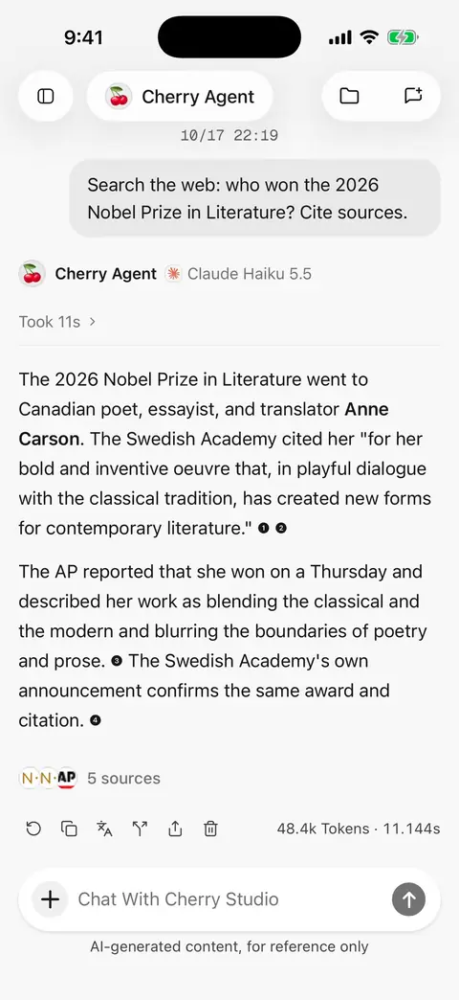
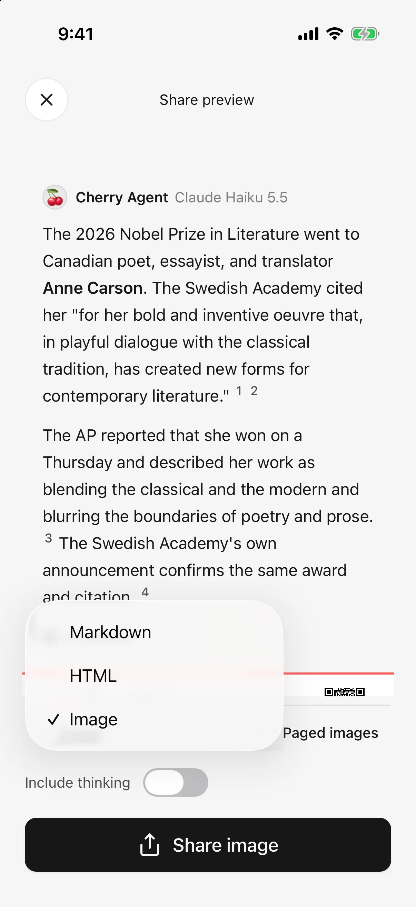

# Sharing and export

Share one answer or turn several exchanges into images, a web document, or editable text. Select content, inspect the preview, then choose the destination.

## Share selected messages

1. Use the answer's share action or a message's share menu.
2. Select messages on the selection page; the original message is selected initially.
3. Confirm to open the fullscreen preview.
4. Choose a format, image layout, and whether to include thinking content.
5. Tap Share and choose a destination in the system sheet.

Only **selected messages** are exported. Questions are not included automatically, so select them when needed for context. Output follows conversation chronology regardless of selection order.

Select up to 128 messages at a time. Unfinished messages cannot be selected. Selection rows show short excerpts; export reads the complete selected content and presents code/images according to the chosen format.

<figure data-mobile-shot="phone"><figcaption>
<strong>iPhone walkthrough</strong> · Share: select messages, preview, and switch between image, HTML, or Markdown
</figcaption></figure>
<figure data-mobile-shot="phone"><figcaption>
<strong>iPhone</strong> · Choose Image, HTML, or Markdown in the preview
</figcaption></figure>

## Include a translation

Expand the translation and select its language in the conversation, then use the original message's share action. Image, HTML, and Markdown include translations expanded when sharing began; collapsed ones are omitted. The thinking-content switch does not affect this. See [Reply translation](translation.md).

## Choose a format

| Format | Good for | Limitations |
| --- | --- | --- |
| PNG images | Direct reading in messaging apps | Paged by default; block-code previews show only their opening portion |
| HTML | Richer layout, complete code, expandable content | Needs a browser or compatible reader |
| Markdown | Keeping source text, code, and tables for further editing | Rendering depends on the receiving app |

Long image exports produce ordered pages; a single-long-image option is also available. Very long single images demand more memory and may fail in receiving apps. Prefer pages, HTML, or Markdown in that case.

Image/HTML exports simplify source presentation. Return to the conversation's original sources for detailed citation checking; an image preview is not a complete source archive.

## Why does the selection screen describe different formats?

Some versions retain an older message saying multi-selection only supports HTML and Markdown. The current preview also supports images for multiple messages; use the formats actually offered in the preview. If image preparation fails, use HTML or Markdown.

## Include thinking and tool activity

These are omitted by default. **Include thinking content** adds visible reasoning, intermediate prose, and readable tool names, without exporting raw tool requests or diagnostic data.

HTML can expand this content; image output expands the included process. Review the preview before sharing unnecessary intermediate details.

## Can Markdown images work offline?

Local/generated PNG and JPEG images are embedded into the Markdown file, which can increase its size. Some readers block embedded images; use HTML or image export if the recipient cannot display them.

Local GIF, WebP, or other formats that cannot be embedded become unavailable-image notes. Other attachments may retain only their names/descriptions; their original files are not all bundled into the document. Share original files separately when needed.

External image URLs remain remote links and are not automatically made available offline.

## Image export failed

If image conversion fails, the app attempts HTML. If HTML preview fails too, it retains Markdown and indicates the available format. Check the format before sharing.

Backgrounding or cancelling interrupts conversion rather than automatically changing format. Keep long exports in the foreground; reduce the selection or use paged images if necessary.

Closing preview returns to message selection. Closing the system share sheet returns to chat. **Opening the share sheet does not prove the destination saved or sent the content.**

## Remove the watermark

Turn off **Settings → General → Share watermark** before exporting. It is on by default and affects future conversation, image, and related file exports. Existing saved/shared files do not change.

## File library and original files

Open **Files** in the sidebar to find imported attachments and saved generated/exported files. Supported images, text, Markdown, HTML, PDF, DOCX, XLSX, and PPTX open in the app. Oversized or unsupported files can open elsewhere.

* Image previews support zoom, sharing, and saving to Photos.
* Large text previews may be partial, and Copy uses displayed content. **Sharing the original file includes the complete original.**
* Failed HTML previews can fall back to source view or be opened elsewhere.
* Keep any needed files before deleting them. Cancelling system sharing does not automatically remove export files already saved to the library.

## Turn HTML into images or slides

For a fully previewable HTML file, choose **Share as image** or **Share as PPT**, wait for conversion, then save through system sharing.

The PPTX slides contain pictures of the pages. They preserve appearance, **not individually editable text, tables, and shapes**. Keep the original when further editing matters.

Before uninstalling or clearing app data, save files outside Cherry Studio or on another device and confirm they open. Files only in the app library can be lost with app data.

Exports preserve selected work. Use [Backup and restore](backup-and-restore.md) for the full mobile app, and [File library](file-library.md) for folder and trash operations.

## Share a generated file or presentation

To share a saved file instead of selected chat messages, open its file card and use the More menu. See [Create and Edit Files](file-generation.md). HTML files also offer [Share as image and Share as PPT](html-export.md); the resulting PPT contains page images, not editable text objects.
