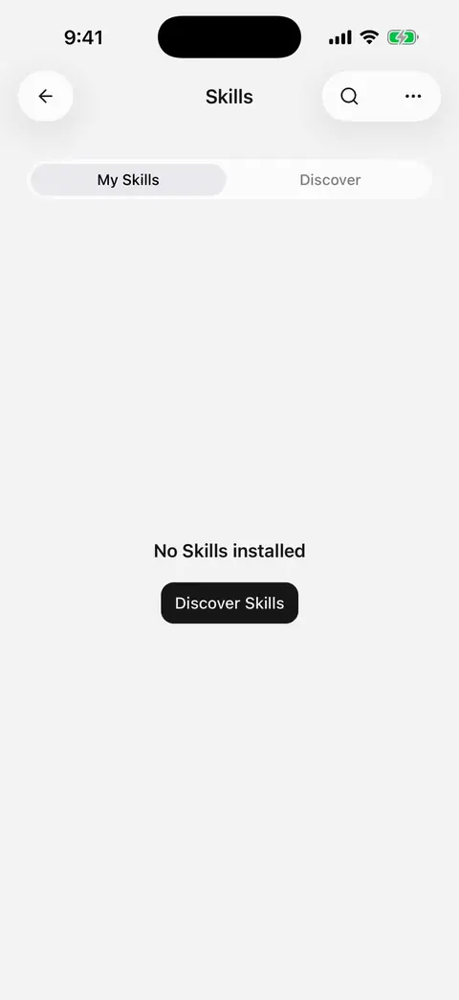
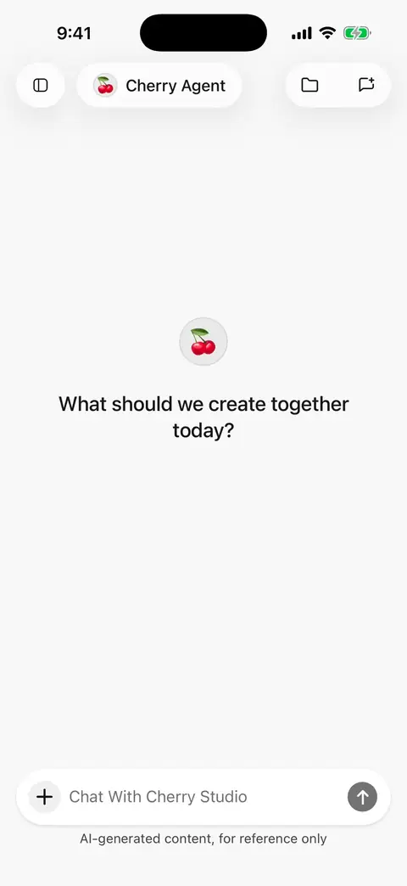

# Skills: install and reuse workflows

Skills package instructions, steps, and reference material for tasks you repeat, such as research reports, meeting notes, or writing workflows. This guide describes Mobile **0.3.0**.

A skill supplies a method. Models, connected tools, and permissions determine what can actually run. Installing a skill does not connect accounts, grant access, or make desktop commands executable on your phone.

## Start in the skill library

1. Open **Skills** in the sidebar and switch to **Discover skills**.
2. Search for your task, open a result, and read its instructions and limitations.
3. Tap **Install**. If a source contains several skills, select the entries you need.
4. Return to the installed list and open the skill to read its full document.

Discovery initially shows skills marked as supporting mobile by CherryIN. You can also choose another available source. A mobile-support label does not mean your model, accounts, and permissions are already configured.

<figure data-mobile-shot="phone"><figcaption>
<strong>iPhone walkthrough</strong> · Skills → Discover → open details → Install
</figcaption></figure>

## Install from a link or ask AI to find a skill

Choose **Add in chat** from the skill page's More menu, then describe a task or provide a public skills.sh or GitHub skill link. For example:

> Find a skill that turns meeting notes into an action list. Explain which tools it needs, then let me choose what to install.

> Install a skill from this public repository: [link]. If it contains several skills, list their names and purposes first.

Follow the candidate results to select and install. Sources must be publicly accessible; an ordinary webpage or private repository is not necessarily a supported source. On failure, keep the error details and check the link, network, and package format.

## Enable a skill for an agent

1. Open the target agent's editor and use **Standard** mode.
2. Enable the installed skill in its skills section.
3. Describe your task in chat, or explicitly reference the skill from the composer's skill picker.

**Enabling** makes the skill available for the agent to choose when relevant. **Referencing it in a message** explicitly requests its method for that task. Installation is shared across the app; each agent's bindings are separate. Minimal mode does not use skills; see [Agents and tools](agents-and-tools.md).

<figure data-mobile-shot="phone"><figcaption>
<strong>iPhone walkthrough</strong> · Enable an installed skill in the agent editor
</figcaption></figure>
<figure data-mobile-shot="phone"><figcaption>
<strong>iPhone walkthrough</strong> · Pick a skill from + → Skills to require it for this message
</figcaption></figure>

## Save your own method as a skill

Choose the skill creation action on the Skills page, or describe a reusable workflow in chat:

> Turn our weekly-report method into a skill: read the materials I supply, then organize progress, risks, and next week's plan. Ask for missing information instead of inventing it. Show me the complete instructions before saving.

Review the proposed name, description, and full steps. Confirm saving and whether to enable it for the current agent. Try it with a small sample before relying on it for a larger task.

## Read, translate, and update

* Read the full document in the details page. **AI translation** lets you choose a target language and return to the original. Translation helps reading; it does not change installed instructions or what the agent receives.
* Completed translations are saved locally and can be read again without another request. Changed skill content needs a new translation. See [Reply and skill-document translation](translation.md) for model settings.
* Use the update action to check or apply source updates. An update uses upstream content; preserve any local instructions you need before updating.
* Uninstalling removes the skill from all agents. Files it helped create remain in the file library.

## Why can an installed skill still fail?

| Situation | What to do |
| --- | --- |
| It needs Feishu or another account | Connect the [relevant plugin](plugins.md) and ensure the account can access the target material |
| It needs search, a calendar, or image generation | Enable the agent capability and configure its model, service, and system permissions |
| It contains scripts or needs missing tools | Mobile does not run scripts bundled with skills; check which steps the app can perform |
| It is installed but absent from the composer | Check the agent binding, Standard mode, and whether the skill allows explicit invocation |
| Its instructions need adapting for mobile | Ask the agent for specific changes and review them before confirming a local update |

Skills cannot expand permissions or change [tool approval rules](using-tools.md). The calculation tool runs restricted code written for the current task; it is not a runner for arbitrary programs bundled with a skill.
