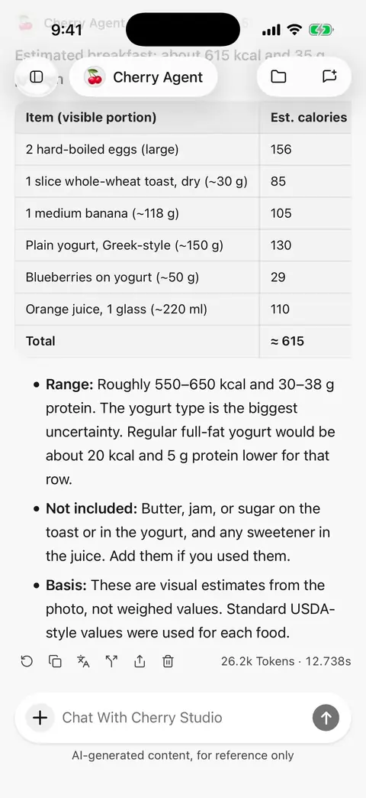

# Reply and skill-document translation

Mobile **0.3.0** can translate completed local-agent replies and skill documents. Translations help reading and sharing; they do not replace original messages or rewrite skill instructions.

## Choose a translation model

Select **Translation model** in **Settings → Default model**. If unset, translation uses the default text model. If an explicitly selected translation model is removed or unavailable, select a replacement; the app does not silently switch models.

Translation sends the original text to that model service and may incur charges. Providers using account sign-in need a usable account session. Translation does not require the agent's search or plugin tools.

## Translate a reply

1. Wait for a text reply to finish in a local-agent conversation.
2. Tap its toolbar's translation button and select a target language. Dismissing the language menu makes no request.
3. Read the translation below the original. Cancel while generating or retry after a failure.
4. Use the translation's language action to switch targets, or copy the active translation. The original toolbar button expands or collapses the result.

Each reply has its own language selection. Completed results in multiple languages remain available after an app restart; returning to a saved translation makes no new model request. Changing the app language does not change translation targets.

Only complete, successful answer text and its code content are translated. Thinking, tool results, and errors are excluded. Remote desktop conversations currently have no message translation action.

<figure data-mobile-shot="phone"><figcaption>
<strong>iPhone walkthrough</strong> · Tap Translate under a reply and choose a language; the translation appears below
</figcaption></figure>

## Include a translation when sharing

Expand the translation and select its language before opening **the original message's share action**. Select that original message in the sharing flow. Image, HTML, and Markdown exports include the translation that was expanded when sharing began.

Collapsed translations are omitted even if saved. The thinking-content switch does not control translation inclusion. See [Sharing and export](sharing-and-export.md).

## Translate a skill document

1. Open an installed, candidate, or discovered skill document in the [skill library](skills.md).
2. Tap **AI translation** and choose a language.
3. After completion, use the same action to switch between the original and saved translation.

Reopening starts on the original, with the cached translation available without another request. When skill content changes, its old translation is not reused for the new document. Reading a translation does not alter the installed skill or the instructions supplied to an agent.

## Missing or outdated translations

| Situation | Explanation and action |
| --- | --- |
| No translation button | Check that this is a completed local-agent text reply; remote or unfinished replies do not offer it |
| Model unavailable | Check the translation model, provider enablement, API key, or signed-in account |
| No result saved after leaving | Incomplete, cancelled, truncated, or failed translations are not saved as successful results |
| A retried reply lost its translation | Changed source content needs a new translation |
| A long translation stops early | Check the model's output capacity or divide material into sections; a truncated result is not complete |

Check important names, numbers, code, and specialist terminology against the original.
