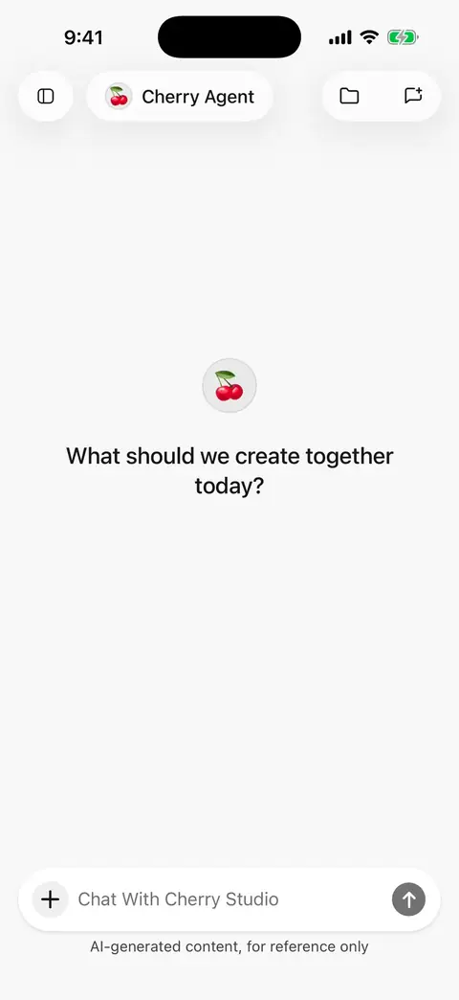

# Web search and page reading

Search finds relevant pages; page reading extracts a particular link's content. Mobile **0.3.0** can use a model provider's native web capabilities or separately configured search and reading services.

## Try a search first

1. Enable **Web search** in the current agent's editor in Standard mode. If you prefer Minimal mode, switch to it after enabling the capability.
2. Choose a model supporting the relevant route and ask “Search for recent project updates and include sources,” or “Read this link and summarize three points: [link].”
3. Inspect web activity and sources, then open original pages to check them.

The composer has no separate web-search switch. Enabling access permits it; it does not force every message to search. Look for actual web activity and sources.

<figure data-mobile-shot="phone"><figcaption>
<strong>iPhone walkthrough</strong> · Ask for a sourced web search, then open Sources to see the pages cited
</figcaption></figure>

## Native model tools or external services?

| Route | When to use it | Requirements |
| --- | --- | --- |
| Native model web access | The model, API, and authentication support provider-executed search or reading | A usable model connection and enabled agent web access |
| External search and reading | You want a particular service, or the model lacks the capability | A tool-capable text model and configured search/reading services |

Configure the source preference and external services through **Plugins → Built-in tools → Web search / URL fetch**. Fresh installs prefer supported native capabilities; existing installs may retain an external-first preference.

Standard mode selects a route before the request according to preference and availability. Search and reading can use different routes. Failure does not trigger automatic attempts through other services. **Minimal mode uses supported native model web capabilities only, without external search tools.** If it cannot search, check model support or switch to Standard mode.

Support depends on the exact model, API, and authentication, not just the provider name. Editing a capability flag cannot create a server capability.

## Change search or page-reading services

1. Open **Plugins** in the sidebar and enter **Web search** or **URL fetch** under built-in tools.
2. Choose a provider and supply its required key, address, or other fields. Search and reading can be configured separately.
3. Use **Check**, then return to chat and send a new request.

Options save through their respective actions. If a service form offers **Save**, submit it before checking. Model credentials and search credentials are usually different; follow the page for services such as Zhipu that share model-provider keys.

Initial external choices remain Exa MCP search and Jina reading, usually without a personal key. This does not mean every web request uses them. Other choices include key-based services, self-hosted SearXNG and Crawl4AI, and Querit; follow the actual list and requirements.

## What is local webpage extraction?

The local reader fetches a page directly from the phone and extracts its text without a separate extraction-service key. Extracted text is still sent to the conversation model. Local extraction does not make the full task offline or keep content from the model provider.

It suits directly accessible public pages. Sites requiring complex scripts, login, or access checks may fail, and the phone must be able to reach the site.

## Should I change advanced settings?

Start with defaults. For external search, adjust result count, content compression, and total content allowance only when needed. More results can increase coverage and usage; a smaller content budget can omit later material.

Page reading has its own content limit. Open original pages for exact checks; repeating a fetch does not necessarily continue where an earlier result was truncated.

## Why does chat work but search fail?

1. Check the agent's Web search capability and whether it is in Minimal mode.
2. For native access, check the exact model, API, and account support.
3. For external services, check model tool calling, service configuration, and its connection check.
4. Read errors and address network, key, permission, credit, or site restrictions separately.

A working chat connection does not prove the search service or target site is reachable. An external web failure stops further external attempts in that turn and uses available material where possible. Fix the cause and send a new message.

## Why cannot I read a signed-in page?

External readers do not inherit your browser login. Local extraction is also different from opening a page in your signed-in browser.

Use the [appropriate plugin](plugins.md) for Feishu, Notion, and other account content, or export material you are authorized to use and add it through [Chat and files](chat-and-files.md).

## Who receives the data?

External search receives queries and reading services receive target links. Native web access is handled by the model provider. Local extraction visits the target directly, then supplies content to the model. Keep keys and unnecessary private material out of search queries. See [Data, privacy, and permissions](data-privacy.md).
