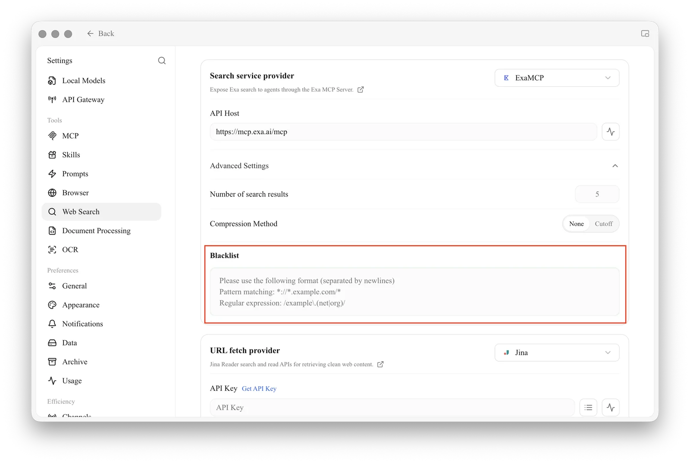

# Web Search Blacklist Configuration

Use the blacklist to keep specific sites out of web search results. Rules follow the format of [ublacklist](https://github.com/iorate/ublacklist).

Open **Settings → Web Search**, expand **Advanced Settings** under the search service provider, and enter rules in the **Blacklist** box, one per line. Rules can be specified using: [Match Patterns](https://developer.mozilla.org/en-US/docs/Mozilla/Add-ons/WebExtensions/Match_patterns) (e.g., `*://*.example.com/*`) or [Regular Expressions](https://developer.mozilla.org/en-US/docs/Web/JavaScript/Guide/Regular_expressions) (e.g., `/example\.(net|org)/`).

## Subscription sources

In **Settings → Web Search → Blacklist subscriptions**, enter an HTTP(S) URL for a uBlacklist-format list and choose **Add**. The list is fetched immediately. Each source shows its parsed rule count, last successful update and any refresh error. Blank lines, comments and invalid rules are ignored; each source is limited to 5,000 rules and a 2 MB response.

Use **Refresh** to update a source or **Delete** to remove it. Sources also refresh every 24 hours while the app is running. A failed refresh keeps the last successful rules, so cached rules still apply offline. Removing a source does not change your manual blacklist.

Fetches follow the app's proxy settings and bypass rules, with a 15-second timeout. For safety, destination DNS must resolve locally and HTTP proxies must allow CONNECT to the destination port. A failed proxy does not trigger a direct fallback. The app's private-network fetch preference still applies.

When upgrading from v1, saved URL sources and cached rules are migrated when available. Some earlier migrations cleared the old subscription data. If your source list is empty after upgrading, add its URLs again.

<figure><figcaption>
Enter blacklist rules in Settings → Web Search → Advanced Settings
</figcaption></figure>
