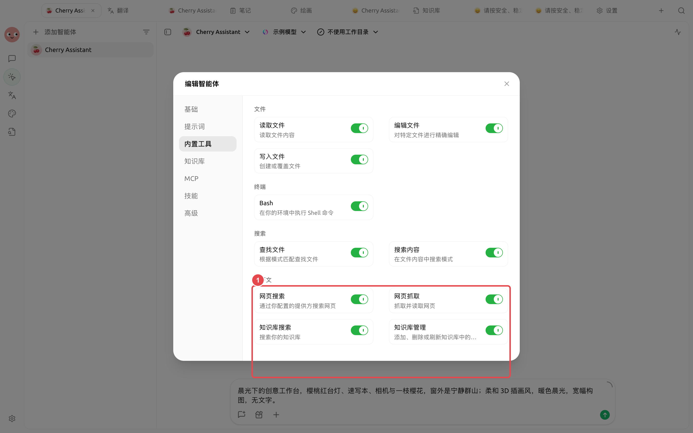
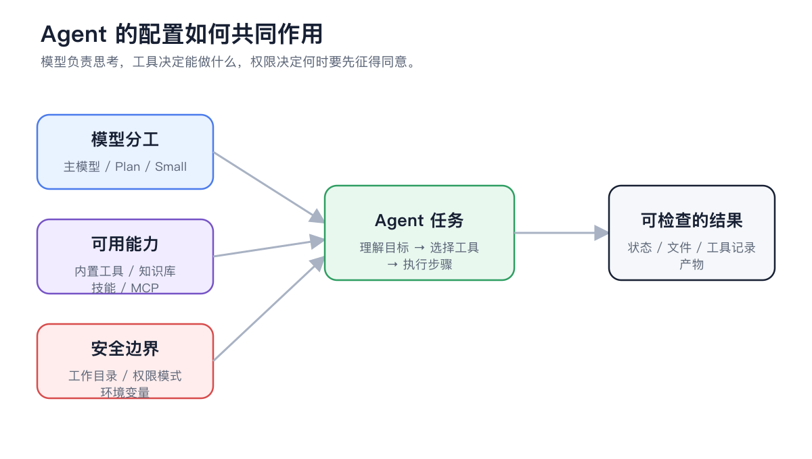

# 与智能体一起使用

把知识库绑定到智能体后，智能体可以在多步任务中搜索和读取授权资料；明确需要更新资料时，还可以启用知识库管理。


普通对话适合一次问答，智能体适合持续研究、比较、生成文件和按步骤验收。智能体只访问配置中绑定的知识库。


## 普通对话与智能体的区别

| 普通对话 | 智能体 |
| ------------ | --------------- |
| 每次消息前临时选择知识库 | 在智能体配置中长期绑定 |
| 适合即时问答和短比较 | 适合多步研究与文件交付 |
| 主要使用召回片段回答 | 可搜索资料，并按权限管理知识库 |
| 当前对话决定资料范围 | 智能体配置决定可访问范围 |

## 配置一名只读知识库智能体



### 1. 先把知识库验收合格

确认目标资料已就绪，并用真实问题完成召回测试。智能体无法补救缺失正文或错误分块。




### 2. 打开智能体编辑窗口

进入【工作】，选择目标智能体，在菜单中打开【编辑智能体】。



### 3. 绑定最小必要知识库

打开【知识库】标签页，点击【添加知识库】。只绑定本任务需要的库，避免跨部门或跨版本资料互相干扰。



### 4. 启用知识库搜索

打开【内置工具】，启用【知识库搜索】。只读研究、问答、总结和比较通常到这里就足够。

<figure><figcaption>
搜索用于读取，管理用于改变资料；默认从最小权限开始。
</figcaption></figure>



### 5. 用边界清楚的任务测试

要求智能体先列来源，再给结论；资料没有支持时明确写出，不允许凭常识补全。



### 6. 验收来源与交付物

检查每条结论来自哪个知识库，文件中的事实和建议是否分开，缺少证据的部分是否被标记。



## 内置工具、知识库、技能和 MCP 怎么选

<figure><figcaption>
查资料用知识库，重复方法用技能，访问外部系统用 MCP；不要用扩大权限代替明确任务。
</figcaption></figure>

## 知识库搜索与管理

| 能力 | 可以做什么 | 适用任务 | 默认建议 |
| ----- | -------------- | ----------- | ----------- |
| 知识库搜索 | 搜索、列出和读取已绑定知识库 | 问答、研究、总结、比较 | 保持启用 |
| 知识库管理 | 添加、删除或刷新知识库文档 | 经批准的资料维护 | 默认关闭，按需临时开启 |


绑定知识库只是授予访问范围，不会复制出另一份知识库。资料更新或重新索引后，智能体下次搜索会使用更新后的内容。



启用【知识库管理】后，添加、删除和刷新会改变资料或索引。批准前确认目标知识库、具体条目、同名冲突方式和回退方案。


## 智能体的配置怎样共同作用

<figure><figcaption>
模型决定理解与生成，知识库提供证据，权限决定智能体能执行到哪一步。
</figcaption></figure>

## 推荐任务模板

### 研究并生成报告

> 在已绑定知识库中找出所有关于海外出差审批和保险的规定。先列来源与冲突点，再生成 Markdown 检查清单。没有资料支持的内容不要补全。

### 更新常见问题

> 搜索住宿报销的现有条目，比较最新制度与旧 FAQ。先给出拟修改清单；获得批准后再刷新相关文档。

### 多知识库对比

> 分别从“产品手册”和“售后案例”知识库寻找证据，按“官方规则 / 真实案例 / 建议话术”三列整理。每条结论保留来源名称。

## 配置说明

| 配置项 | 推荐起点 | 何时增加 | 风险控制 |
| ----- | ---------- | ------------ | ------------- |
| 绑定知识库 | 1 个任务相关库 | 确有跨库比较需求 | 在提示词中写清每个库的用途 |
| 知识库搜索 | 开启 | 只要任务需要查资料 | 验收来源是否来自绑定范围 |
| 知识库管理 | 关闭 | 明确需要添加、删除或刷新 | 逐项批准，并先备份重要资料 |
| 输出要求 | 事实、推断、建议分开 | 需要生成报告或文件 | 每条事实保留来源名称 |

## 用户案例

小林为售后智能体绑定【官方手册】和【审核案例】，只启用知识库搜索。他要求智能体按设备型号列出安全警告、官方步骤和案例建议，并把三者分开。发现旧案例需要更新时，才临时开启管理工具，先查看拟修改清单再批准。

完成标准是：智能体不访问未绑定资料，不把案例建议写成官方规则，所有写操作都有明确目标和验收结果。

## 结果验收

* 来源只来自当前智能体绑定的知识库。
* 搜索结果覆盖任务中的每个条件。
* 交付物把资料事实、智能体推断和建议分开。
* 管理操作说明了目标、影响和结果。
* 更新资料后重新运行固定召回问题。

## 常见问题

普通对话能搜到，智能体为什么搜不到？

检查目标知识库是否绑定到当前智能体，以及【知识库搜索】是否启用。不同智能体的绑定范围互不继承。

什么时候不该开启知识库管理？

只读研究、团队共享制度库和保留历史版本的资料库，默认都只开启搜索。需要更新时再临时开启管理并逐项批准。

智能体想操作未绑定的知识库怎么办？

不要扩大到所有知识库。确认任务确实需要后，再把目标库加入当前智能体，或改用已经绑定该库的智能体。

## 继续阅读

<table data-view="cards"><thead><tr><th></th><th></th><th data-hidden data-card-target data-type="content-ref"></th></tr></thead><tbody><tr><td><strong>在对话中使用</strong></td><td>完成一次即时、带来源的问答。</td><td><a href="chat.md">chat.md</a></td></tr><tr><td><strong>数据、隐私与维护</strong></td><td>理解权限、云端服务和备份边界。</td><td><a href="data.md">data.md</a></td></tr><tr><td><strong>知识库应用案例</strong></td><td>参考售后与研究工作流。</td><td><a href="cases.md">cases.md</a></td></tr></tbody></table>
