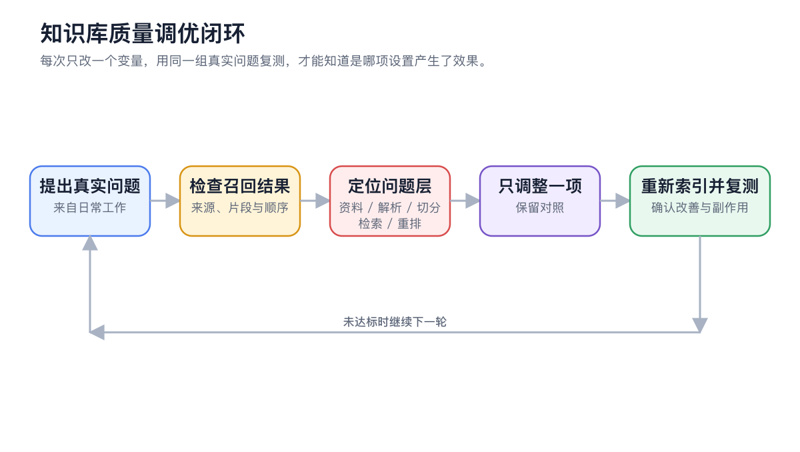

# 知识库应用案例

知识库是否可靠，不取决于资料数量，而取决于边界是否清楚、来源是否可维护，以及真实问题能否稳定召回正确证据。


下面的参数只作为起点。先用 3～10 份代表性资料跑通导入、召回和使用，再根据固定问题集扩充。


## 先用同一套方法设计



### 1. 写清最终任务

明确用户要做的判断或交付物，例如查询制度、排查故障或生成研究报告。



### 2. 划定资料边界

只有使用时应该一起检索的资料才放在同一知识库。权限、生命周期、产品型号或版本不同的内容优先分开。



### 3. 选择来源和更新方式

说明文件、笔记、目录和网页由谁维护，何时替换，是否需要保留历史版本。



### 4. 准备验收问题

准备 3～10 个真实问题，覆盖精确事实、条件规则、口语问法和容易混淆的版本。



### 5. 调整检索方案

先保留简单配置。BM25 不足以处理同义表达时再加嵌入；候选正确但顺序不稳时再加重排。




### 6. 接入对话或智能体

一次问答使用普通对话；需要多步研究、比较和文件交付时绑定智能体。上线前逐条核对来源。



## 用户案例一：员工制度问答

### 目标

让员工查询差旅审批、住宿标准和报销例外，并能打开来源核对原文。

### 资料组织

* 知识库：【员工差旅制度】
* 条目：【出差审批流程】
* 条目：【住宿标准速查】
* 条目：【差旅常见问题】

<figure><figcaption>
制度条款和 FAQ 分开维护，更新其中一份时不必重做全部资料。
</figcaption></figure>

### 推荐配置

| 项目 | 起点 | 何时调整 |
| ---- | ---------- | ----------------- |
| 检索 | 先用 BM25 | 员工问法与制度措辞差异大时增加嵌入 |
| 重排 | 先不使用 | 正确候选已出现但顺序不稳定时启用 |
| 资料版本 | 只保留当前版 | 历史审计需要并存时在名称中写明年份 |
| 回答要求 | 结论、条件、来源分开 | 资料未说明时明确标记 |

### 验收问题

1. 出差住店最高能报多少？
2. 海外租车能否报销？
3. 预计总费用超过 5000 元时由谁审批？
4. 未经批准先订酒店会怎样处理？

### 对话提示词

> 只根据“员工差旅制度”回答。先给结论，再列适用条件和来源；资料没有说明时写“制度未说明”，不要用常识补全。


验收通过时，同一条制度用原文问法和口语问法都能命中，回答中的金额、角色和条件可以由引用直接支持。


## 用户案例二：产品售后助手

### 目标

把官方手册、故障代码和已审核案例组织起来，让客服先给安全、可追溯的排查建议。

### 资料边界

| 知识库或资料组 | 内容 | 维护原则 |
| ------- | ------------- | ------------- |
| 官方手册 | 规格、保修边界、标准步骤 | 保留型号和文档版本 |
| 故障代码 | 一条故障一个小节 | 标注适用固件和设备型号 |
| 审核案例 | 已确认原因与解决方案的案例 | 未审核聊天记录不得直接导入 |

不同型号规则差异明显时，按型号拆成独立知识库，避免相同故障码互相竞争。

### 检索与智能体配置

* PDF 先抽查目录、表格和双栏正文。
* 故障码依赖精确术语，保留 BM25。
* 客户描述较口语化时增加嵌入模型。
* 给售后智能体绑定官方手册和审核案例，只启用【知识库搜索】。

> 根据设备型号、故障码和现象分三步排查。每一步标明依据来自官方手册还是审核案例。涉及拆机、用电或数据清除时，先提示风险并等待确认。

### 验收标准

* 不把其他型号的步骤用于当前型号。
* 安全警告出现在操作步骤之前。
* 官方规则和案例建议分开。
* 无资料支持时转人工，不猜测。

## 用户案例三：研究资料与报告

### 目标

从论文、访谈笔记和网页快照中提取可核对证据，再由智能体生成带来源的比较报告。

### 资料组织

* 按研究问题建库，不把所有论文塞进一个大库。
* 文件名包含作者、年份和短标题。
* 访谈笔记标明受访者角色、日期和是否可引用。
* 网页资料记录抓取日期，因为知识库保存的是导入快照。

<figure><figcaption>
研究库先用固定问题验证来源覆盖，再交给智能体做跨文档归纳。
</figcaption></figure>

### 智能体提示词

> 在已绑定研究知识库中查找“用户为何放弃首次配置”的证据。先按来源列出原始观点和限制，再归纳共识、分歧和待验证假设。最终生成 Markdown 报告；不得把推断写成受访者原话。

### 从证据到交付物

<figure><figcaption>
先保留证据和限制，再让智能体整理为报告；不要让成品反过来掩盖原始来源。
</figcaption></figure>

### 验收标准

* 共识由至少两个独立来源支持。
* 分歧保留各自条件，不强行合并。
* 引用、推断和建议有明确标识。
* 网页快照和论文版本可追溯。

## 配置说明：可复用设计表

| 项目 | 要回答的问题 |
| ---- | ---------------------- |
| 目标 | 用户最终要做出什么判断或交付什么结果？ |
| 边界 | 哪些资料应该一起检索，哪些必须分开？ |
| 来源 | 文件、笔记、目录和网页怎样更新？ |
| 解析 | 哪类文档最容易出现 OCR、表格或顺序问题？ |
| 检索 | BM25 是否足够？何时需要嵌入和重排？ |
| 验收问题 | 哪 3～10 个问题代表真实使用？ |
| 失败处理 | 无结果、冲突版本和无资料支持时怎么办？ |
| 维护 | 谁负责替换资料、重新索引和备份？ |


不要把“导入了很多资料”当成完成标准。资料越多，重复版本、权限混合和噪声竞争越需要被显式管理。


## 常见问题

制度、手册和案例应该放在同一个知识库吗？

看它们是否应该在同一问题中共同检索，以及权限和更新周期是否一致。差异明显时拆库更容易控制来源边界。

案例库可以直接导入全部客服聊天吗？

不建议。先审核原因、解决方案和隐私内容，只导入已确认、可复用的案例。

扩充资料前需要做什么？

保留一组固定验收问题，分批导入并复测。新增资料让结果退化时，能快速定位是哪一批内容造成的。

## 继续阅读

<table data-view="cards"><thead><tr><th></th><th></th><th data-hidden data-card-target data-type="content-ref"></th></tr></thead><tbody><tr><td><strong>知识库入门</strong></td><td>先跑通创建、导入、召回和使用。</td><td><a href="knowledge-base.md">knowledge-base.md</a></td></tr><tr><td><strong>与智能体一起使用</strong></td><td>配置多步研究和资料权限。</td><td><a href="agent.md">agent.md</a></td></tr><tr><td><strong>常见问题</strong></td><td>从症状定位资料、召回或回答问题。</td><td><a href="troubleshooting.md">troubleshooting.md</a></td></tr></tbody></table>
