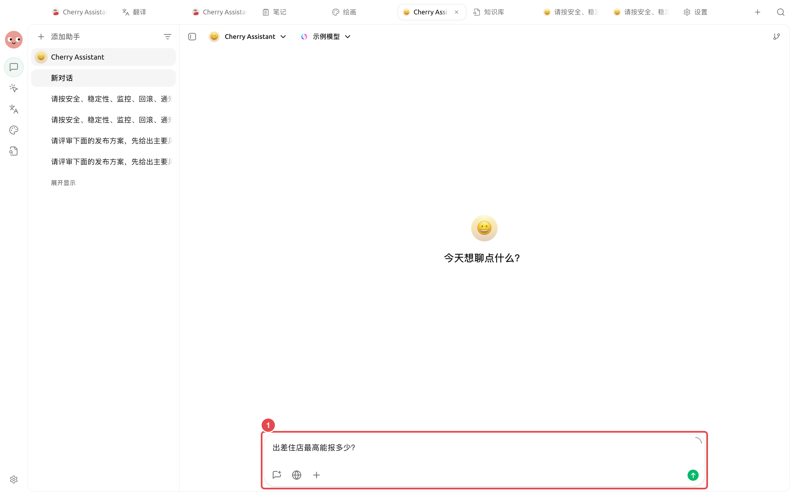
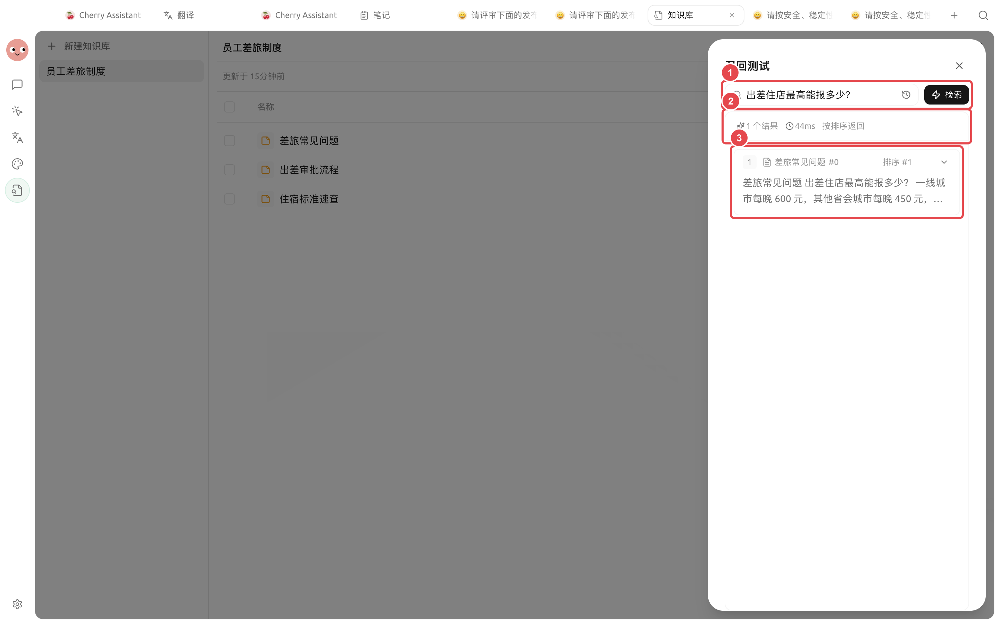

# 在对话中使用

召回测试合格后，可以在普通对话中选择一个或多个知识库，让模型基于召回片段回答并显示来源。


对话负责组织答案，知识库负责提供证据。先在【召回测试】确认正确片段，再判断提示词或聊天模型是否需要调整。


## 使用前提

| 检查项 | 合格状态 |
| ----- | ---------------- |
| 聊天模型 | 支持工具调用 |
| 知识库资料 | 至少一条资料已就绪 |
| 当前消息 | 没有同时附加文件 |
| 召回质量 | 关键问题能找到正确来源和完整片段 |


当前消息带有附件时，知识库选择会被禁用。先移除附件，再从输入区选择知识库。


## 完成一次带来源的问答



### 1. 选择支持工具调用的模型

新建或打开普通对话，在模型选择器中确认当前模型支持工具调用。若知识库入口提示能力不足，先更换模型。



### 2. 打开知识库选择

点击输入区左下角的添加按钮，选择【知识库】，再勾选一个或多个目标库。



### 3. 确认选择状态

知识库名称应出现在输入区。问题只涉及一个主题时，优先只选一个库，减少无关片段竞争。

<figure><figcaption>
发送前先确认选中的知识库和当前问题属于同一资料范围。
</figcaption></figure>



### 4. 写清任务、范围和格式

例如：`只根据已选择的知识库回答国内一线城市住宿上限；不同职级分项列出，每项标注来源。`



### 5. 打开来源核对

检查来源名称、片段内容和适用条件。资料未说明的内容，不应被当成事实补全。



### 6. 失败时回到召回测试

用相同问题检查知识库返回的片段。召回错误先修资料、解析或检索；召回正确再调整提示词和聊天模型。

<figure><figcaption>
对话回答不理想时，召回结果能帮助判断问题在检索层还是回答层。
</figcaption></figure>



## 回答是怎样形成的

<figure><figcaption>
聊天模型看到的是最终召回片段，不是自动阅读知识库中的全部资料。
</figcaption></figure>

## 推荐提问模板

### 查询一条明确规则

> 只根据已选择的知识库回答：国内一线城市住宿上限是多少？如不同职级标准不同，请分项列出，并在每项后标注来源。

### 对比多份资料

> 对比国内出差和海外出差的审批差异。按“触发条件、审批人、出发前材料”列成表格；资料没有写明的地方标记为“未说明”。

### 要求区分事实和建议

> 先列出制度原文支持的事实，再单独给出操作建议。建议不得写成制度要求，每条事实保留来源名称。


一个好问题同时包含四件事：要完成的任务、允许使用的资料范围、期望输出格式，以及资料缺失时该怎么处理。


## 选择一个还是多个知识库

| 情况 | 建议 | 原因 |
| --------- | -------------- | --------------- |
| 单一制度或产品问题 | 只选一个库 | 减少无关片段竞争 |
| 跨部门或跨产品比较 | 选择多个库并说明各自用途 | 帮助模型保持来源边界 |
| 多库结果混杂 | 拆成多个问题分别验证 | 先确认每个库都能独立召回 |
| 需要长期多步研究 | 改用绑定知识库的智能体 | 更适合持续搜索、整理和交付文件 |

## 配置说明

| 配置项 | 推荐起点 | 作用 | 注意事项 |
| ----- | ----------- | --------- | ------------ |
| 知识库数量 | 1 个 | 控制资料范围 | 只在确有跨库需求时增加 |
| 提问范围 | 明确写“只根据知识库” | 减少常识补全 | 重要结论仍需核对来源 |
| 输出格式 | 表格或分项列表 | 方便逐条验收 | 要求“未说明”而不是猜测 |
| 回归问题 | 与召回测试使用同一问题 | 区分检索和回答问题 | 每轮只改变一个变量 |

## 把对话内容沉淀回知识库

Cherry Studio 可以把消息、话题或笔记保存到知识库。保存前删除模型猜测、重复内容和临时讨论，并使用能说明主题和版本的标题。

保存后形成新的资料快照，不会与原对话或笔记实时同步。内容更新时需要重新保存或替换。

## 用户案例

小林在【员工差旅制度】中提问住宿上限。第一次回答混入了模型常识，他把提示词改为“资料未说明时写未说明”，并要求每项保留来源。随后逐条打开引用核对城市级别、职级和金额。

完成标准是：每个金额都能由引用片段直接支持，制度未写明的例外不会被模型自行补全。

## 常见问题

知识库入口为什么是灰色的？

先选择支持工具调用的模型，并移除当前消息附件；再确认存在至少一个有就绪资料的知识库。

回答为什么没有来源？

确认输入区仍显示已选知识库，再把相同问题放入召回测试。没有正确召回时先修复知识库。

来源正确但结论不准确怎么办？

要求模型只依据引用回答，把任务拆成更小的事实项，并人工核对重要结论。此时通常是提示词、模型能力或上下文组织问题。

## 继续阅读

<table data-view="cards"><thead><tr><th></th><th></th><th data-hidden data-card-target data-type="content-ref"></th></tr></thead><tbody><tr><td><strong>检查资料与召回</strong></td><td>先确认正确片段能够稳定命中。</td><td><a href="recall-test.md">recall-test.md</a></td></tr><tr><td><strong>与智能体一起使用</strong></td><td>让知识库参与多步任务和文件交付。</td><td><a href="agent.md">agent.md</a></td></tr><tr><td><strong>知识库应用案例</strong></td><td>复用制度、售后和研究案例。</td><td><a href="cases.md">cases.md</a></td></tr></tbody></table>
