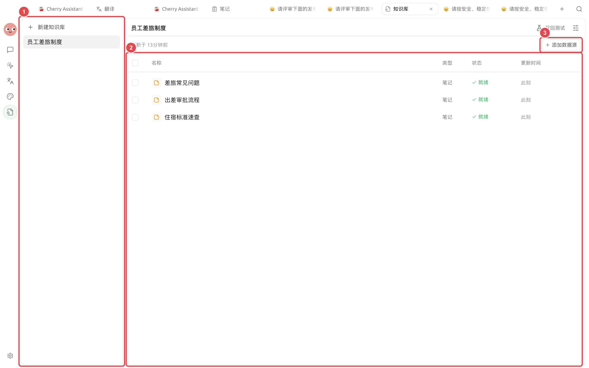
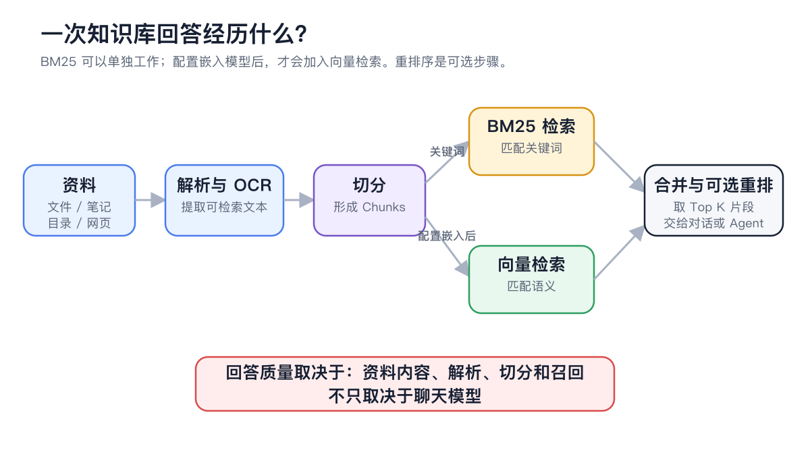

# 数据、隐私与维护

知识库会保存导入资料的托管副本、解析文本、Chunks 和检索索引。数据是否离开本机，取决于解析、OCR、嵌入、重排和聊天各环节选择的服务。


原文件留在本地，不代表整个知识库流程离线。只要其中一个处理环节使用云服务，就可能发送完成任务所需的文件、片段或查询。


## 导入后保存什么

| 内容 | 用途 | 更新方式 |
| ------------ | ----------- | --------------- |
| 文件或目录中的文件副本 | 供知识库继续处理和展示 | 原文件更新后重新添加或替换 |
| 网页和笔记快照 | 保留导入时的内容 | 来源更新后重新导入 |
| 解析正文与 Chunks | 预览和检索 | 更换处理器或分块后重新索引 |
| BM25 关键词索引 | 精确词语检索 | 重新索引时重建 |
| 向量索引 | 语义检索 | 配置或更换嵌入模型后生成或重建 |

<figure><figcaption>
资料列表中的条目是知识库托管和索引的对象，不是对原目录的实时同步视图。
</figcaption></figure>

## 一次查询可能经过哪些边界

<figure><figcaption>
图中的解析、向量、重排和回答节点都可能选择本地或云端服务；逐项检查才能确定数据边界。
</figcaption></figure>

| 选择的能力 | 可能接收的内容 |
| ------- | ------------- |
| 云端文档处理器 | 用于解析的文件内容 |
| 云端嵌入模型 | 资料片段和检索查询 |
| 云端重排模型 | 查询和候选片段 |
| 云端聊天模型 | 问题、对话上下文和召回片段 |
| 本地对应能力 | 在本机完成相应处理 |


API Key、内部文档和带个人信息的日志都不应出现在公开截图或反馈中。删除或分享前先脱敏。


## 做一次完整的维护检查



### 1. 记录当前配置

记录知识库名称、文件处理器、OCR、嵌入模型、重排模型和关键分块设置。迁移后用它们核对环境。



### 2. 清理重复和旧版本

同一制度只保留当前版本；需要历史审计时，在标题中明确年份或版本，避免检索时互相竞争。



### 3. 检查异常条目

处理【错误】或长期【处理中】的资料，抽查正文和 Chunks。应用中断导致索引未完成时，执行【重新索引】。



### 4. 创建合适的备份

打开【设置】→【数据】。迁移设备或准备删除资料时使用包含知识库数据文件的完整备份。



### 5. 在目标环境恢复并验收

不要只确认恢复完成。检查知识库条目、正文、Chunks，并运行固定的召回问题。



### 6. 保留可回退基线

新处理器或模型先在少量资料上验证，再分批重新索引。确认新结果稳定前，不要删除最近的完整备份。



## 完整备份与精简备份

| 备份方式 | 包含内容 | 适用场景 | 限制 |
| ---- | ------------------------ | --------------- | ----------- |
| 完整备份 | 聊天、设置及知识库等数据文件 | 迁移设备、删除前保护、完整恢复 | 文件较大，耗时更长 |
| 精简备份 | 主要是聊天记录和设置，跳过图片、知识库等数据文件 | 快速保留常用配置和聊天 | 不能单独恢复完整知识库 |


精简备份不是知识库删除前的恢复保障。重要迁移至少保留一份完整备份，并在目标环境实际完成召回测试。


## 更新和删除怎么处理

### 来源内容更新

1. 重新添加同名资料。
2. 需要覆盖旧版本时选择【替换】；只有确实要并存时才选择【全部保留】。
3. 等待资料变为就绪。
4. 抽查正文和 Chunks。
5. 运行固定的召回回归问题。

### 处理设置更新

只改变处理器、OCR、分块或模型设置时，对现有条目执行【重新索引】。修改配置本身不会自动重做旧资料。

### 删除资料或知识库

删除会移除知识库托管的内容和索引，但不会删除原路径中的文件或原笔记。操作前确认原始来源仍可找到、完整备份可用，并检查是否仍有智能体绑定该知识库。

## 配置说明

| 项目 | 推荐起点 | 验收方式 | 风险 |
| ---- | ---------- | ----------- | ------------ |
| 资料版本 | 同一用途只保留当前版 | 固定问题只命中正确版本 | 新旧规则混用 |
| 云端服务 | 按敏感等级逐项确认 | 查看处理器和模型配置 | 文档或片段发送到外部服务 |
| 备份 | 大改前创建完整备份 | 恢复后检查条目和召回 | 精简备份缺少知识库文件 |
| 重新索引 | 分批处理代表性资料 | 同一问题集前后对比 | 一次性重建失去可用基线 |

## 用户案例

小林要把团队制度库迁移到新电脑。他先记录处理器和模型配置，创建完整备份，在新电脑恢复后检查三条资料的正文与 Chunks，并重复原来的五个召回问题。全部通过后，他才清理旧环境。

完成标准是：资料数量和标题一致，关键问题仍命中同一来源，且团队确认所有云端服务符合数据要求。

## 完全离线检查清单

* 文档解析与 OCR 使用系统、本地或自托管能力。
* 嵌入模型在本机运行。
* 不使用云端重排，或使用本地重排能力。
* 对话与智能体使用本地聊天模型。
* 没有启用会把内容发送到外部系统的 MCP、网络搜索或频道。

## 常见问题

修改原文件后，知识库会自动更新吗？

不会。文件、网页和笔记都是按导入时内容建立资料。重新添加并替换，或按需要重新索引。

使用本地嵌入模型就完全离线了吗？

不一定。解析、OCR、重排或聊天中的任一环节使用云服务，都可能发送完成任务所需的内容。

精简备份能恢复知识库吗？

不能恢复完整知识库文件。迁移或删除前使用完整备份，并在恢复后实际验证资料与召回。

## 继续阅读

<table data-view="cards"><thead><tr><th></th><th></th><th data-hidden data-card-target data-type="content-ref"></th></tr></thead><tbody><tr><td><strong>文档解析与 OCR</strong></td><td>了解本地与云端处理器的差异。</td><td><a href="document-preprocessing.md">document-preprocessing.md</a></td></tr><tr><td><strong>添加与整理资料</strong></td><td>替换来源并管理资料版本。</td><td><a href="sources.md">sources.md</a></td></tr><tr><td><strong>常见问题</strong></td><td>按失败层级快速定位问题。</td><td><a href="troubleshooting.md">troubleshooting.md</a></td></tr></tbody></table>
