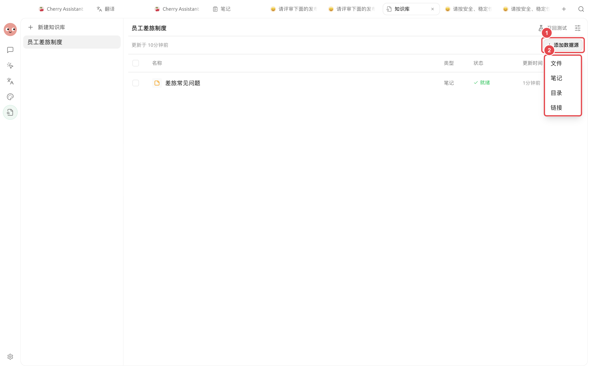

# 知识库入门

知识库把文件、笔记、目录或网页整理成可以反复检索的资料集合。先用召回测试确认系统能找到正确片段，再把知识库交给对话或智能体使用。


如果只是临时处理一小段文字，直接粘贴到对话更快。资料会反复使用、答案必须以内部材料为准时，再建立知识库。


第一次使用从本页开始。已有明确任务时，可以直接查看[创建知识库](create.md)、[添加资料](sources.md)、[召回测试](recall-test.md)、[在对话中使用](chat.md)或[与智能体一起使用](agent.md)。

## 什么时候适合使用

| 需求 | 建议做法 | 原因 |
| ---------------- | ----------- | ---------------------- |
| 查询员工制度、产品手册、项目资料 | 建立知识库 | 资料会重复使用，需要稳定引用原文 |
| 临时分析一个附件 | 在对话中直接上传 | 不需要长期维护和索引 |
| 资料还在持续整理 | 先用【笔记】梳理 | 避免未确认内容被当成正式答案 |
| 需要长期自动处理资料 | 建库后绑定智能体 | 智能体可以在任务中持续使用同一资料范围 |

## 一次回答经历什么

<figure><figcaption>
资料先经过解析和切分，再用关键词或语义找出候选片段；聊天模型只负责基于召回内容组织回答。
</figcaption></figure>

### 先认识这些词

| 名称 | 在本任务中的含义 |
| ----- | ------------------------------- |
| 知识库 | 围绕同一主题组织的一组资料和检索设置 |
| 资料条目 | 导入的一个文件、笔记、目录中的文件或网页快照 |
| Chunk | 资料切分后用于检索的小片段 |
| 召回 | 根据问题找出相关片段的过程 |
| 嵌入模型 | 把文字转换为向量，用于匹配不同表达但意思相近的内容；不是必选项 |
| 重排模型 | 对候选片段再次评分和排序；也是可选项 |


没有嵌入模型也能使用知识库，此时主要依靠 BM25 关键词检索。第一次体验可以先选【不使用】，把创建、导入和召回流程跑通。


## 5 分钟完成第一次使用



### 1. 创建一个边界清楚的知识库

打开左侧导航【知识库】→ 点击知识库列表上方的新增按钮。名称使用“对象 + 用途”，例如【员工差旅制度】。



### 2. 选择检索方式

第一次体验可以把【嵌入模型】设为【不使用】。需要匹配口语问法或同义表达时，再配置嵌入模型。



### 3. 添加资料

进入知识库后点击添加资料按钮，选择【文件】、【笔记】、【目录】或【链接】。

<figure><figcaption>
按资料来源选择入口；不要为了减少操作把无关目录一起导入。
</figcaption></figure>



### 4. 等待资料变为就绪

处理完成后，资料会出现在列表中。抽查正文和 Chunks，确认没有乱码、缺页或明显错序。

<figure><figcaption>
资料就绪后仍要抽查内容；导入完成不等于检索质量已经合格。
</figcaption></figure>



### 5. 完成召回测试

打开【召回测试】，输入一个你已经知道答案的真实问题，检查正确来源是否出现在前几条结果中。




### 6. 进入对话或绑定智能体

召回稳定后，在对话输入区选择知识库；需要长期工作流时，在智能体编辑页绑定知识库。



## 推荐起点

| 配置项 | 产品默认值 | 建议起点 | 作用 | 适用场景 | 注意事项 |
| ------ | ----- | ----------------- | -------------- | ----------- | ------------------ |
| 知识库范围 | — | 一个明确主题 | 控制一起参与检索的资料 | 制度、产品、项目资料 | 权限或生命周期不同的内容应分开 |
| 嵌入模型 | 不使用 | 先不使用 | 决定是否加入向量检索 | 口语问法与原文差异较大 | 云端模型的计费与数据处理取决于服务商 |
| 测试问题 | — | 3～5 个真实问题 | 建立长期回归基线 | 每次更新资料或设置后 | 不要只用资料标题和原句测试 |
| 进入正式使用 | — | 资料、Chunks、召回三项都通过 | 避免把解析或检索问题带入对话 | 所有知识库 | 聊天模型无法补回没有召回的关键信息 |

## 怎样判断已经可以使用

* 需要的资料都显示为可用状态，没有长期停在处理中或错误状态。
* 随机打开一两条资料，正文和 Chunks 没有乱码、缺页或明显错序。
* 用固定问题进行召回测试，正确来源能够稳定出现在前几条结果中。

## 用户案例

小林要让同事查询差旅制度。他创建【员工差旅制度】知识库，导入住宿、交通和审批三份资料，先不配置嵌入模型。三份资料就绪后，他用“北京住宿上限是多少”“5000 元以上谁审批”等问题测试。

完成标准是：每个问题都能找到正确制度来源，片段同时包含适用条件和结论。只有达到这个标准后，他才把知识库绑定到负责员工问答的智能体。

## 常见问题

知识库和聊天模型有什么区别？

知识库负责从你的资料中找片段，聊天模型负责理解问题并组织回答。召回阶段没有找到关键信息时，单纯更换聊天模型通常不能解决问题。

资料导入成功后可以直接使用吗？

还需要抽查正文和 Chunks，并完成召回测试。导入成功只代表处理流程结束，不代表结果完整或排序正确。

修改分块设置后，旧资料会自动变化吗？

不会。要让已有资料使用新分块设置，需要执行【重新索引】，再用同一组问题复测。

## 继续阅读

<table data-view="cards"><thead><tr><th></th><th></th><th data-hidden data-card-target data-type="content-ref"></th></tr></thead><tbody><tr><td><strong>创建知识库</strong></td><td>确定名称边界和检索方式。</td><td><a href="create.md">create.md</a></td></tr><tr><td><strong>添加与整理资料</strong></td><td>导入文件、笔记、目录和网页。</td><td><a href="sources.md">sources.md</a></td></tr><tr><td><strong>检查资料与召回</strong></td><td>用固定问题验收检索质量。</td><td><a href="recall-test.md">recall-test.md</a></td></tr><tr><td><strong>模型与检索设置</strong></td><td>继续调整嵌入、重排和分块。</td><td><a href="emb-models-info.md">emb-models-info.md</a></td></tr></tbody></table>
