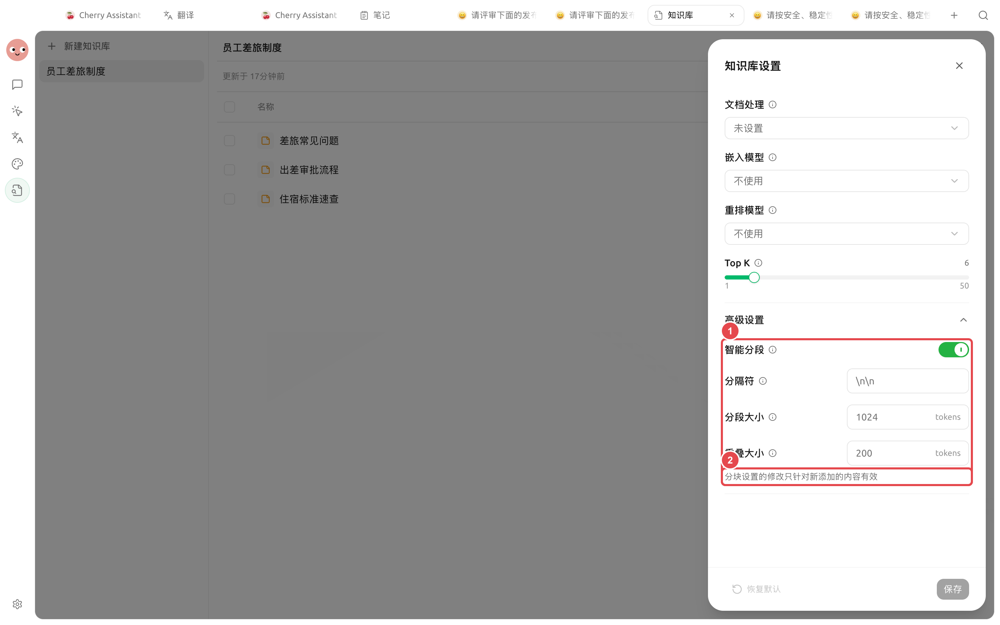

# 常见问题

遇到知识库问题时，先判断失败发生在导入、解析、分块、召回还是回答层。一次只改变一个变量，才能知道哪项调整真正有效。


最快的定位方法是用同一个真实问题贯穿检查：正文有没有答案、Chunk 是否完整、召回是否正确、回答是否忠于来源。


## 5 步快速定位



### 1. 检查资料状态

资料应为【就绪】。如果长期处理中或显示错误，先查看错误信息，并确认文件、处理器和模型服务可用。



### 2. 检查解析正文

打开正文预览，确认答案确实存在，扫描文字已经识别，双栏和表格没有错序。



### 3. 检查 Chunks

确认问题需要的条件和结论位于可理解的片段中；不要让页眉、页脚和目录占满结果。

<figure><figcaption>
正文正确但片段不完整时，再调整分块，并重新索引旧资料。
</figcaption></figure>



### 4. 运行召回测试

检查来源名称、相关度和片段内容。完全没有正确片段与正确片段排序靠后，是两类不同问题。

<figure><figcaption>
先证明检索层返回了正确证据，再调整对话提示词。
</figcaption></figure>




### 5. 检查对话或智能体

召回正确但回答错误时，确认已选择或绑定知识库，要求只依据来源回答，并把问题拆成更小的事实项。



## 问题应该反馈到哪里

<figure><figcaption>
先完成最小排查；可稳定复现时附上脱敏步骤、错误和预期结果。
</figcaption></figure>


截图、日志和示例资料中不要公开 API Key、内部文件内容、邮箱或本地敏感路径。


## 创建与导入

没有嵌入模型能创建知识库吗？

可以。选择【不使用】后仍会使用 BM25 关键词检索。需要匹配不同表达时再增加嵌入模型。

支持哪些来源和文件格式？

来源包括文件、Cherry Studio 笔记、本地目录和网页链接。文件格式包括 PDF、DOCX、DOC、PPTX、XLSX、XLS、Markdown、TXT、CSV、HTML 和 EPUB。

一次可以添加多少项？

一次交互式选择最多 20 项。更多资料可以分批添加，或使用目录入口。

同名资料选【全部保留】还是【替换】？

更新制度、手册或笔记快照时通常选【替换】。只有确实需要并存的版本才选【全部保留】，并在名称中加入日期或版本。

资料一直停在处理中怎么办？

检查文件能否打开、处理器和 OCR 是否可用、模型服务是否已配置。根据错误信息判断失败在读取、解析还是嵌入阶段。

## 解析与召回

扫描 PDF 为什么没有文字？

扫描件需要 OCR。打开【设置】→【文档处理】选择可用 OCR，再重新索引文档。复杂版式可尝试专用文档处理器。

修改 Chunk 设置后为什么结果没变化？

新设置不会自动重做旧资料。对相关条目执行【重新索引】，再用同一问题复测。

召回测试完全没有结果怎么办？

依次检查资料状态、正文是否包含答案、原文关键词能否命中、嵌入是否完成、重排阈值是否过高，以及 Top K 是否过小。

来源正确但片段不完整怎么办？

查看 Chunks，确认条件与结论是否被切开。适当增大 Chunk 或重叠，或把结构混乱的源资料整理成清晰笔记后重新索引。

正确结果排得太后怎么办？

先删除重复和过期资料，再考虑嵌入模型。候选大致正确但顺序不稳时，可以增加重排并重新调节阈值。

Top K 应该设置多少？

可以从 6 开始，用固定问题比较漏召回、噪声和耗时。Top K 可在 1～50 之间调整，不要把调大当成通用修复。

## 对话与智能体

对话中的知识库入口不可用怎么办？

选择支持工具调用的模型，并移除当前消息附件。还要确认至少有一个知识库包含就绪资料。

回答没有显示来源怎么办？

确认输入区确实选中了知识库，再把相同问题放入召回测试。召回没有正确片段时先修复知识库。

召回正确，回答仍然不准怎么办？

要求模型只依据引用回答，把任务拆成更小的事实项，并人工核对重要结论。此时问题通常在提示词、模型或上下文组织。

智能体为什么看不到知识库？

打开【编辑智能体】→【知识库】，把目标库绑定到当前智能体，并在【内置工具】中启用【知识库搜索】。

知识库管理会改变资料吗？

会。【知识库管理】支持添加、删除或刷新文档。只读任务不要启用；写操作前检查目标、影响和回退方式。

## 模型、数据与备份

更换嵌入模型为什么要求重建？

不同嵌入模型生成的向量不能直接混用。先确认新模型可用并保留完整备份，再重建已有向量索引。

重排和相似度阈值是什么关系？

重排对候选片段重新打分，阈值过滤重排后的低分结果。未配置重排时，知识库设置中不会显示相似度阈值。

本地嵌入模型下载后就完全离线了吗？

不一定。解析、OCR、重排和聊天也必须全部使用本地能力，才是完全离线流程。

修改原文件或网页会自动更新吗？

不会。文件、笔记和网页按导入时内容建立资料。重新添加同名资料并选择【替换】，再完成召回测试。

精简备份包含知识库文件吗？

不包含完整知识库数据文件。迁移或删除前使用完整备份，并在恢复后验证资料与召回。

## 配置说明：诊断基线

| 项目 | 推荐起点 | 只在什么情况下调整 |
| ----- | ------------- | ---------------- |
| Top K | 6 | 正确片段被截掉或噪声过多 |
| 相似度阈值 | 配置重排后从 0.0 开始 | 低分噪声明显，且正确片段仍有余量 |
| Chunk | 保留默认智能分段 | 条件与结论被切开或片段过长 |
| 嵌入模型 | BM25 不足时再增加 | 口语问法、同义表达无法稳定命中 |
| 重排模型 | 候选正确但顺序不稳时增加 | 不用于修复解析错误或缺失正文 |

## 用户案例

小林发现“住宿费标准”在聊天里回答错误。他先用相同问题做召回测试，看到正确来源根本没有出现；打开正文后发现双栏 PDF 已错序。更换处理器并重新索引后，召回正确，聊天回答也恢复正常。

这个过程只改变了解析器一个变量，因此能确认根因，而不是靠同时调大 Top K、Chunk 和阈值碰运气。


仍然无法解决时，请记录应用版本、操作系统、处理器、嵌入与重排模型、完整错误、脱敏最小样本、召回结果和预期来源。


## 继续阅读

<table data-view="cards"><thead><tr><th></th><th></th><th data-hidden data-card-target data-type="content-ref"></th></tr></thead><tbody><tr><td><strong>文档解析与 OCR</strong></td><td>解决扫描、错序和表格丢失。</td><td><a href="document-preprocessing.md">document-preprocessing.md</a></td></tr><tr><td><strong>模型与检索设置</strong></td><td>理解嵌入、重排、阈值和重建。</td><td><a href="emb-models-info.md">emb-models-info.md</a></td></tr><tr><td><strong>数据、隐私与维护</strong></td><td>确认备份与云端服务边界。</td><td><a href="data.md">data.md</a></td></tr></tbody></table>
