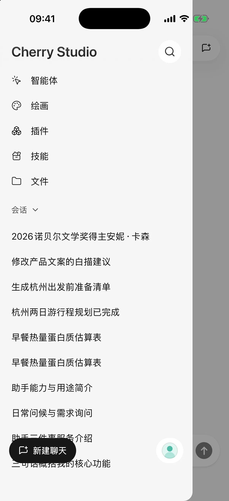
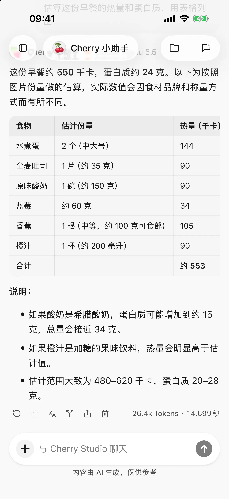

# Cherry Studio 移动版

Cherry Studio 移动版是为 Android、iPhone 与 iPad 设计的 AI 客户端。你可以连接自己的模型服务，进行对话、使用技能与插件、在画板中创作图片，并用文件夹组织任务资料。

本组教程按移动版 **0.3.0** 整理。电脑智能体需要兼容的桌面端；各商店与测试渠道的版本可能不同，以设备实际安装版本为准。

- **第一次使用**：[快速开始](quick-start.md)，连接模型并发出第一条消息。
- **完成一个任务**：[日常使用](#日常使用)，查找聊天、图片、文件与分享教程。
- **遇到问题**：[常见问题](troubleshooting.md)，按错误提示排查。

<figure data-mobile-shot="phone"><figcaption>
<strong>iPhone</strong> · 侧边栏集中了智能体、绘画、插件、技能、文件和最近对话
</figcaption></figure>
<figure data-mobile-shot="phone"><figcaption>
<strong>iPhone</strong> · 发送照片后由视觉模型整理成表格
</figcaption></figure>

## 当前状态

移动版已上架 Google Play 与 App Store：

* Android 推荐从[国内站下载页](https://cherryai.com.cn/download?platform=mobile)下载 APK（GitCode），也保留 [Google Play](https://play.google.com/store/apps/details?id=com.cherryai.cherrystudio_app) 安装入口。
* iPhone 与 iPad 可从[国区 App Store](https://apps.apple.com/cn/app/cherry-studio-%E5%85%A8%E8%83%BD-ai-%E5%B7%A5%E4%BD%9C%E7%AB%99/id6809783714) 安装，也保留 TestFlight 测试版入口。
* 界面与功能可能随版本调整，具体以你安装的版本为准。

前往[下载页的移动端选项](https://cherryai.com.cn/download?platform=mobile)，或先阅读[安装指南](installation.md)。

## 按你现在的需求开始

### 开始使用

[下载与安装](installation.md) · [快速开始](quick-start.md) · [从电脑导入配置](desktop-sync.md)

### 日常使用

[对话与文件](chat-and-files.md) · [回复与技能文档翻译](translation.md) · [文件库与共享工作区](file-library.md) · [联网搜索与网页阅读](web-search.md) · [图片生成](image-generation.md) · [生成与修改文件](file-generation.md) · [HTML 转图片与 PPT](html-export.md) · [分享与导出](sharing-and-export.md)

### 智能体与自动化

[智能体与工具](agents-and-tools.md) · [技能：安装与复用任务流程](skills.md) · [在手机使用电脑智能体](remote-chat.md) · [让 AI 使用工具](using-tools.md) · [日历与提醒事项](calendar-and-reminders.md) · [位置与健康记录](location-and-health.md) · [插件与外部工具](plugins.md)

### 配置与数据

[服务商与模型](providers-and-models.md) · [模型管理](model-management.md) · [模型信息与列表更新](model-updates.md) · [设置、用量与后台回复](settings-and-usage.md) · [备份与恢复](backup-and-restore.md) · [数据、隐私与权限](data-privacy.md)

### 故障排查

[常见问题](troubleshooting.md) · [如何高效提问](../question-contact/ask.md) · [反馈问题](../question-contact/suggestions.md)

### 开发者与贡献

[移动版文档贡献与问题报告](development.md)

这些教程覆盖近期移动版功能。旧版本缺少相应入口时，先通过官方渠道更新；截图中的示例名称和模型列表可能与你的配置不同。

> Cherry Studio 是客户端，不附带模型额度。模型调用与已连接服务的费用、使用范围由对应平台决定。
