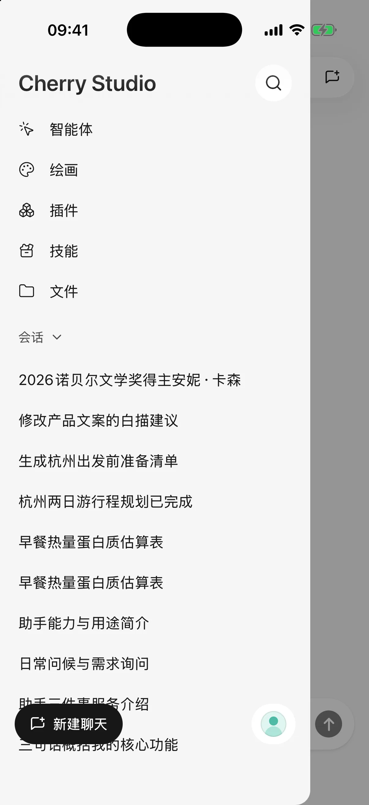
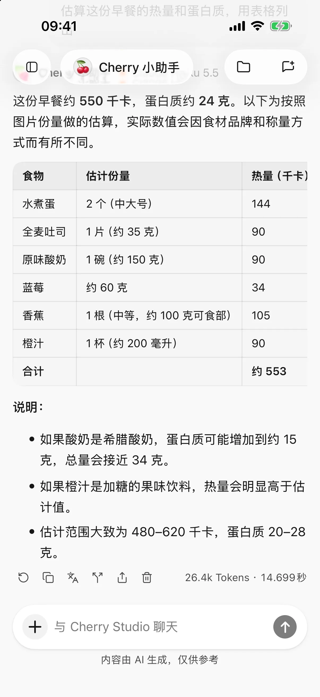

# Cherry Studio 移动版

Cherry Studio 移动版为 Android、iPhone 与 iPad 提供模型对话、智能体、技能、插件、文件处理与图片创作，也能连接电脑智能体和远程服务器。

- **首次使用**：[快速开始](quick-start.md)，选择账号或服务商并发出第一条消息。
- **从旧版升级**：[旧功能有哪些变化](#从旧版升级先看这些变化)，再按对应教程操作。
- **遇到错误**：先做[错误检查与 AI 诊断](diagnostics.md)，再按[常见问题](troubleshooting.md)处理。

<figure data-mobile-shot="phone"><figcaption>
<strong>iPhone</strong> · 从侧边栏进入智能体、绘画、插件、技能和文件
</figcaption></figure>
<figure data-mobile-shot="phone"><figcaption>
<strong>iPhone · 对话示例</strong> · 把照片中的信息整理成表格
</figcaption></figure>

## 当前状态

* Android 可从[国内站下载页](https://cherryai.com.cn/download?platform=mobile)获取 GitCode APK，也保留 [Google Play](https://play.google.com/store/apps/details?id=com.cherryai.cherrystudio_app)。
* iPhone 与 iPad 可从[国区 App Store](https://apps.apple.com/cn/app/cherry-studio-%E5%85%A8%E8%83%BD-ai-%E5%B7%A5%E4%BD%9C%E7%AB%99/id6809783714)安装，TestFlight 用于可用的测试版本。
* 安装步骤、更新方式和渠道切换注意事项，见[下载与安装](installation.md)。

## 从旧版升级，先看这些变化

| 以前的做法 | 现在的操作 |
| --- | --- |
| 先给智能体开启搜索、日历、绘图等能力 | 内置能力开关已移除，按模型、平台、服务与系统权限提供工具；技能/MCP 仍需添加到智能体，见[智能体](agents-and-tools.md) |
| 重新回答替换唯一答案 | 支持多模型回复和保留不同路径，也能编辑问题后建立新分支，见[对话分支](conversation-branches.md) |
| 分享时开思考选项、选择分页长图 | 在原对话选消息，只导出问题与最终内容；聊天图片有高度上限，完整内容选 HTML / Markdown，见[分享](sharing-and-export.md) |
| 内置工具只能生成文本，PPT 要先转 HTML | 现在可直接创建、编辑原生 Word / Excel / PowerPoint；HTML 转换仍是图片式 PPT，见[文件生成](file-generation.md) |
| 在设置首页找备份 | 备份、DeepSeek 导入与运行缓存清理集中在 **设置 → 数据**，见[数据设置](settings-and-usage.md) |
| 技能只展示标注为移动兼容的项目 | 发现目录不再使用旧移动筛选，安装后仍需核对实际工具需求，见[技能](skills.md) |

## 按你现在的需求开始

### 开始使用

[下载与安装](installation.md) · [快速开始](quick-start.md) · [账号与组织空间](accounts-and-organizations.md) · [从电脑导入配置](desktop-sync.md)

### 日常使用

[对话与文件](chat-and-files.md) · [多模型回复与对话分支](conversation-branches.md) · [语音与音频转写](voice.md) · [回复与技能文档翻译](translation.md) · [文件库与共享工作区](file-library.md) · [生成与修改文件](file-generation.md) · [HTML 转图片与 PPT](html-export.md) · [联网搜索与网页阅读](web-search.md) · [图片生成](image-generation.md) · [分享与导出](sharing-and-export.md)

### 智能体与自动化

[智能体与工具](agents-and-tools.md) · [技能](skills.md) · [让 AI 使用工具](using-tools.md) · [日历与提醒事项](calendar-and-reminders.md) · [位置与健康记录](location-and-health.md) · [插件与外部工具](plugins.md)

### 电脑与服务器

[电脑智能体与定时任务结果](remote-chat.md) · [UU 远程桌面](remote-desktop.md) · [SSH 远程服务器](ssh.md)

### 配置与数据

[服务商与模型](providers-and-models.md) · [模型管理](model-management.md) · [模型信息与列表更新](model-updates.md) · [导入 DeepSeek 对话](deepseek-import.md) · [设置、用量与后台回复](settings-and-usage.md) · [备份与恢复](backup-and-restore.md) · [数据、隐私与权限](data-privacy.md)

### 故障排查

[错误检查与 AI 诊断](diagnostics.md) · [常见问题](troubleshooting.md) · [如何高效提问](../question-contact/ask.md) · [反馈问题](../question-contact/suggestions.md)

### 开发者与贡献

[移动版文档贡献与问题报告](development.md)

> 自己连接的模型服务需要自己的可用额度；已有社区权益与组织模型按对应账号服务授权，插件和其他平台的费用另由各服务决定。
