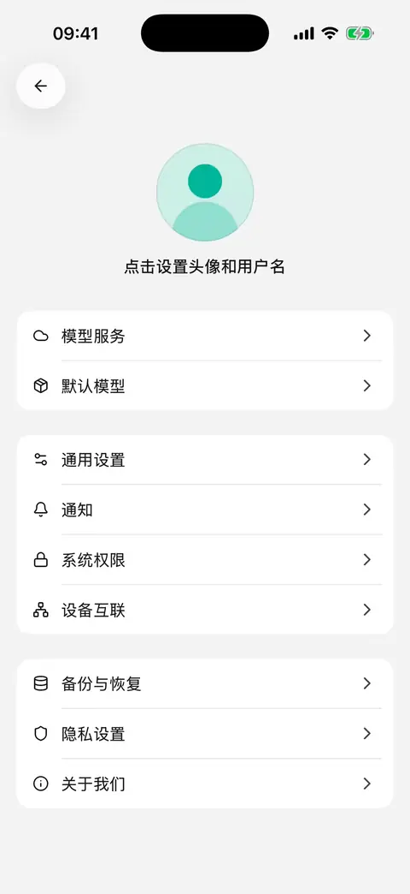

# 备份与恢复

换手机、重装或清理数据前，可以在 **设置 → 备份与恢复** 创建移动版的完整备份。本文按 **0.3.0** 整理。

分享聊天适合保存成果；完整备份用于恢复 App 中的聊天、智能体、配置和文件。两者用途不同。

## 创建并保存备份

1. 等当前对话、绘画等任务结束，并等待配置保存完成。
2. 打开 **设置 → 备份与恢复 → 创建备份**。
3. 等待处理完成，查看备份的时间、会话、消息、文件数量和大小。
4. 选择 **保存到文件** 或 **分享**，将备份保存到 App 之外的位置。
5. 到目标位置确认备份文件确实存在；仅打开或关闭系统分享面板不代表已经保存。

处理期间页面会显示进度，可以等待或取消。不要只把重要备份留在这台手机上；卸载前将其复制到可独立访问的位置。

**备份未加密，包含聊天内容，以及数据库里保存的模型密钥和自定义工具请求头。** 不要把完整备份作为公开反馈附件。

<figure data-mobile-shot="phone"><figcaption>
<strong>iPhone 操作演示</strong> · 设置 → 备份与恢复 → 创建备份，确认数量后保存到文件或分享
</figcaption></figure>

## 备份包含什么？

| 包含 | 不包含或恢复后需处理 |
| --- | --- |
| 本机聊天、智能体、模型服务和一般配置 | 电脑端的远程会话历史仍由电脑保存 |
| 文件、绘画、头像、文件夹与工作区关联 | 系统权限需按新设备情况重新授权 |
| 已安装技能及相关配置 | 插件授权、系统安全存储里的登录凭据不随包复制，相关账号需重新连接 |
| 回收站内容及原删除时间 | 电脑连接需重新配对；已经过期的回收站内容可能在恢复启动时清理 |

恢复保留目标设备自身的部分偏好，包括设备身份、隐私选择和后台通知设置；其余支持的数据从备份恢复。未完成任务不会因此重新执行。

## 恢复到手机

1. 先为当前设备创建备份，保存仍需要的数据。
2. 选择 **选择备份恢复**，从文件选择器打开移动版备份包。
3. 等应用检查格式、兼容性和完整性。读取失败时按提示处理，不要重复点击确认。
4. 核对来源设备、App 版本、时间和内容数量。
5. 确认 **替换当前数据**。恢复会替换当前的聊天、智能体、设置和文件，**不会与现有记录合并**。
6. 按提示重新打开应用。支持的 Android 客户端会自动重启；其他情况需要彻底关闭后重开。
7. 查看恢复结果，再检查重要会话和文件，重新连接插件、登录账号并配对电脑。

如果恢复未能生效，应用会提示并保留恢复前的数据。不要把“已选择备份”或“正在准备恢复”当作已经完成。

## 限制与常见问题

* 当前支持本地完整备份和替换恢复，不提供定时备份、WebDAV / S3 自动备份、部分恢复或与桌面版备份互导。
* 备份最大 1 GB、最多 10,000 个文件；压缩前的数据也有容量限制。准备备份和恢复都需要额外可用空间。
* 来自不兼容版本、不同数据结构或损坏的包会被拒绝。不要假设新版本备份一定能恢复到旧版 App。
* 提示原始文件缺失时，应用不能生成完整备份。先保留仍可访问的重要成果，再通过[意见反馈](troubleshooting.md)说明错误。
* 提示忙碌时先结束任务；提示空间不足时清理设备空间后重试。

电脑配置导入与本机完整备份分别说明，见[从电脑导入配置](desktop-sync.md)。只需要保存几条问答时，使用[分享与导出](sharing-and-export.md)。
