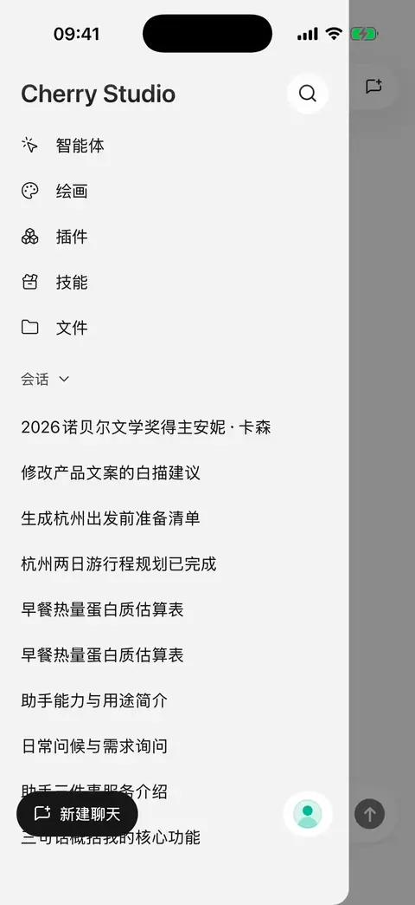
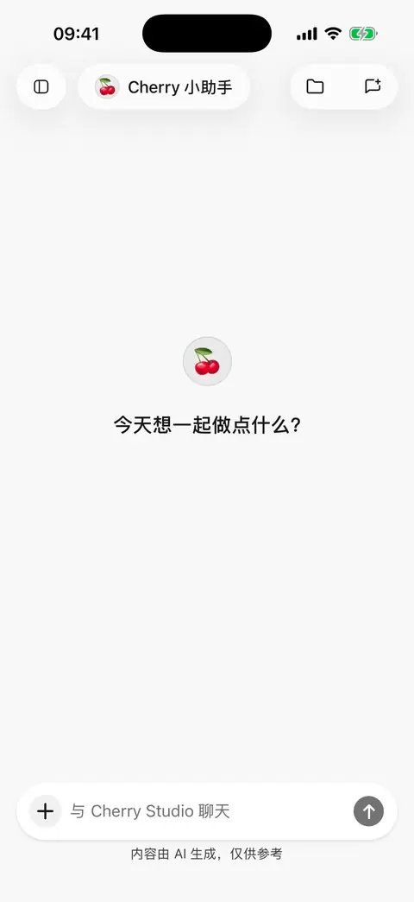

# 对话与文件

一段对话用于持续讨论一个主题；智能体决定使用哪个模型，以及回答时应遵循什么要求。不同主题可以使用同一个智能体分别新建对话，避免把无关材料混在一起。

## 开始对话与切换模型

从侧边栏选择 **新对话**，在对话页选择智能体和模型后发送消息。新对话先作为草稿打开，发送第一条消息后才会形成对话记录。

在对话中单选模型会更新当前智能体，下一次发送使用新选择，已生成的回答不重写。模型选择器也支持多选文字模型并行回答；多选不覆盖智能体的默认模型，详见[多模型与分支](conversation-branches.md)。

如果只想改变长期回答风格，例如“先给结论，再列步骤”，把要求写进[智能体说明](agents-and-tools.md)。只对这次问题生效的要求直接写进消息即可。

## 找回以前的对话

* 侧边栏的最近对话可按时间浏览，也可以通过最近列表的菜单切换为按智能体分组。点击智能体名称展开或收起，重开应用会保留已选的浏览方式。
* 点击侧边栏标题旁的搜索按钮，可同时搜索**对话标题和消息内容**；尚未输入关键词时先显示最近对话。
* 点击消息搜索结果，会打开该消息所在位置。可以继续向前后阅读，或点击 **返回最新消息** 回到对话末尾。
* 在侧边栏长按会话进入多选，可批量删除并在操作前确认。需要的内容先[导出](sharing-and-export.md)或[备份](backup-and-restore.md)。删除会话不进入文件回收站，也不会删除其附件和工作区文件。

搜索定位的是整条消息，不会把正文里的每个关键词都高亮；当前搜索范围是对话，不是手机里的所有文件。平板、折叠屏或宽窗口可并排显示侧边栏、文件与聊天，顶部按钮可收起侧栏；旋转与窗口变化不等于切换到另一段会话。树形/平铺展示见[分支教程](conversation-branches.md)。

<figure data-mobile-shot="phone"><figcaption>
<strong>iPhone 操作演示</strong> · 搜索“杭州”，同时命中对话标题和消息内容，点击结果跳到原消息
</figcaption></figure>
<figure data-mobile-shot="phone"><figcaption>
<strong>iPhone 操作演示</strong> · 长按进入多选，批量删除前会再次确认
</figcaption></figure>

## 添加图片

点击输入框旁的 **＋**，选择照片、拍照，或通过文件入口添加图片。需要理解画面时选择支持视觉的模型，可使用“视觉”筛选。文字模型也可在支持的设备上先进行本机 OCR（识别图片中的文字），但识别文字不等于理解整个画面。

例如发送一张照片并问：“帮我把图里的清单整理成表格。”文字里写清楚要看图片的哪一部分，会比只发图片更容易得到需要的回答。

当前支持 JPEG、PNG、GIF、WebP 图片，单张不超过 **30 MiB**。本机聊天不再统一限制每次请求的图片总张数和总大小，但仍受模型能力、服务商限制和上下文容量约束；绘图模型的参考图数量另有限制。不兼容的格式可先转为 JPEG 或 PNG。

部分较大的 JPEG、PNG、WebP 会在导入时缩小；GIF、生成图片或无法重新编码的图片可能保持原样。发送超限后不要假设应用一定会再次压缩重试。

发送前可打开附件图片进入编辑，裁剪、旋转、翻转、拉直或调整透视，并使用撤销、重做和原图对比。保存后使用编辑结果，原图保留；取消不会替换当前附件。

<figure data-mobile-shot="phone"><figcaption>
<strong>iPhone 操作演示</strong> · 添加照片 → 写清要求 → 当前模型不支持图片时切换到视觉模型 → 发送
</figcaption></figure>

## 添加文档与已有文件

1. 点击 **＋ → 文件**。
2. 浏览文件库中的文件夹并选择已有文件，或点击上传，从系统文件选择器导入。
3. 写出具体任务，例如“总结第二部分的结论，并列出待办事项”。

本机聊天的文本文件单个不超过 **5 MiB**，PDF 单个不超过 **50 MiB**，其他支持的文档单个不超过 **20 MiB**。1 MiB 为 1024 × 1024 字节。文本提取和模型上下文另有限制，不能假设文件大小合规就能全文读入；PDF 文本提取仍最多处理前 **100 页**。

PDF、DOCX、XLSX、PPTX 现可在应用内预览，过大或不支持时从菜单用其他应用打开。需要让多段对话共用项目资料时，通过 **＋ → 文件夹** 关联[工作区](file-library.md)。远程电脑附件使用[不同的传输限制](remote-chat.md)。

### 文档解析器选哪个？

在 **设置 → 通用设置 → 文档解析器** 选择，选择后立即保存，之后处理文档时使用，不会改写之前的回答：

| 选项 | 适合什么情况 | 注意事项 |
| --- | --- | --- |
| 内置 | 以文字为主的摘要和问答 | 支持 PDF、DOCX、XLSX、PPTX 的文本提取，较节省模型用量 |
| AnyDoc（保留文档结构的解析方式） | 需要理解标题、表格等结构的复杂文档 | 非 PDF 文档可保留更多结构，但消耗的模型用量通常更多 |

PDF 使用原生文本提取，支持的设备也可对扫描页面进行本机 OCR；切换内置/AnyDoc 不改变这条 PDF 路径。留意未识别页、截断和失败提示；无法识别时提供可选中文字的版本，或将相关页面交给视觉模型。文本模型接收图片时也可先本机识字，动画图像只识别第一帧。

**能预览文件不等于模型能理解文件。** 文档提供的是解析内容；音频可在本机转写后提供文字（单个不超过 100 MiB、2 小时），见[语音教程](voice.md)。视频与压缩包不能仅靠修改能力标记变成可读附件。

希望把回答保存为清单、表格或网页，或继续修改已有文件，见[生成与修改文件](file-generation.md)。已保存的 HTML 还可以[转为图片或 PPT](html-export.md)。

## 从其他应用分享过来

在浏览器、相册或文件应用的系统分享菜单中选择 **Cherry Studio**，再选择智能体或本机已有对话。支持的文字和附件会放入输入区；检查内容、补充要求后，由你点击发送，不会自动向模型提交。

选择智能体会打开新的草稿输入区，可能替换原有未发送草稿。分享前先保留重要的未发送文字；附件仍受上述格式、大小和模型能力限制。

## 复制、重新回答、分支与删除

| 操作 | 当前行为 |
| --- | --- |
| 选择文字或复制 | 可插入多处引用并穿插追问，或复制正文 |
| 重新回答、追加模型回答 | 在同一问题下保留可切换的回答路径，不再仅替换唯一答案 |
| 编辑已发送问题 | 修改并重发为新分支，保留原问题和后续讨论 |
| 编辑已完成回答 | 空闲且提供编辑入口时修改正文，之后的对话可使用修改后的内容 |
| 在新聊天中创建分支 | 在独立会话中继续，原会话保留 |
| 删除这轮对话 | 按实际选择移除问答记录，不能从文件回收站恢复 |

具体入口、分支阅读和多模型的只读工具限制见[多模型回复与对话分支](conversation-branches.md)。操作是否可用取决于消息状态，运行中先等结束或按页面停止。

重新回答会产生新请求，删除或修改正文都**不会撤销已经创建的日程、修改过的文件或发出的内容**，也不会退回费用。需要保留成果时先分享或备份。

## 长消息、排队与翻译

输入框可展开为大编辑器，写完返回或发送。回复进行时提交的消息进入队列；点开队列项可看完整文字与附件，移除未开始的消息，或取回草稿修改再发。提供 **引导** 时，也可把排队的补充要求交给当前任务，供后续执行参考，见[排队与引导](conversation-branches.md#排队取回与引导)。

队列会保留到会话状态中，重开应用后可恢复待处理消息。模型请求失败后也会继续处理可执行的后续消息。需要取消某条任务时，应从队列明确移除；不要把离开页面或切到后台当作取消。

已完成的本机文字回复可从工具栏[翻译为其他语言](translation.md)，保留多个完成的译文，并随分享导出。

## 思考深度与长对话

支持的模型会在输入区提供 **思考深度** 调整。档位由模型决定，不同模型不一定都有“关闭”或相同数量的选项。简单问答可以使用默认或较快档位，复杂分析再尝试更高档位；更深的思考可能更慢、消耗更多用量。

输入区可查看当前分支的上下文占用与模型容量，带 **≈** 的数值是估计，不是累计费用或历史回答的输入量。不同模型窗口与当前压缩状态会改变它。

长对话或连续工具操作中出现 **正在压缩上下文 / 已压缩上下文**，表示应用正在把较早的信息整理为摘要，腾出继续回答的空间。聊天记录仍在，但模型后续看到的摘要可能没有所有原文细节；关键限制、数字或原文引用可以在下一条消息里重新提供。

压缩也不能容纳任意大的单份材料。仍然提示内容过多时，减少附件或在新对话中处理。

切换后台后任务中断或没有通知，见[后台回复与通知](settings-and-usage.md)。想分享多条问答，见[分享与导出](sharing-and-export.md)。
