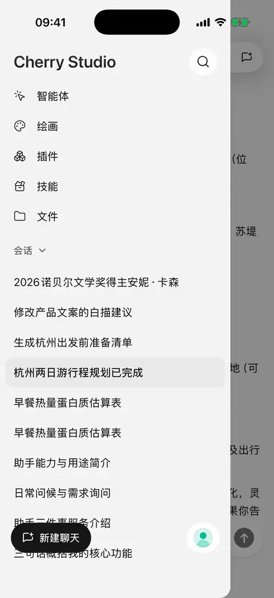
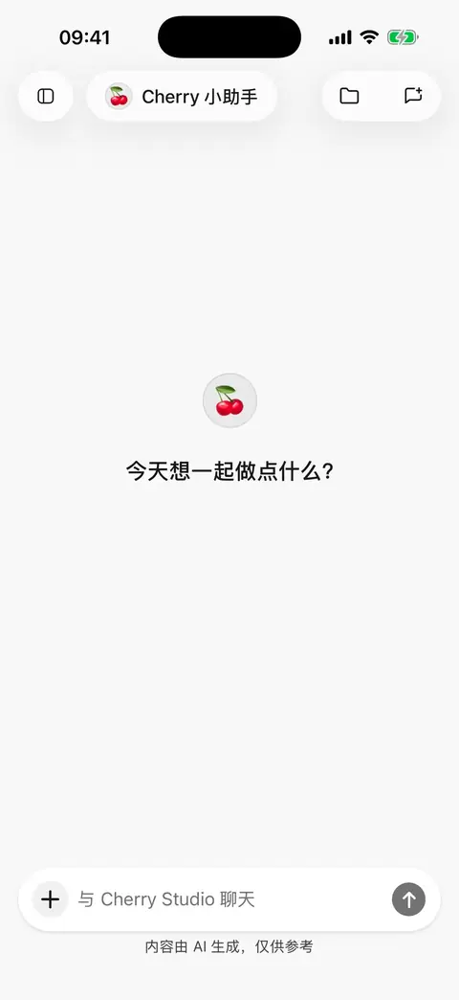

# 对话与文件

一段对话用于持续讨论一个主题；智能体决定使用哪个模型，以及回答时应遵循什么要求。不同主题可以使用同一个智能体分别新建对话，避免把无关材料混在一起。

## 开始对话与切换模型

从侧边栏选择 **新对话**，在对话页选择智能体和模型后发送消息。新对话先作为草稿打开，发送第一条消息后才会形成对话记录。

可以在对话中切换模型，不需要先离开页面。这个选择会更新当前智能体的模型，下一次发送时使用新选择；已经生成的回答不会因此重写。

如果只想改变长期回答风格，例如“先给结论，再列步骤”，把要求写进[智能体说明](agents-and-tools.md)。只对这次问题生效的要求直接写进消息即可。

## 找回以前的对话

* 侧边栏的最近对话可按时间浏览，也可以通过最近列表的菜单切换为按智能体分组。点击智能体名称展开或收起，重开应用会保留已选的浏览方式。
* 点击侧边栏标题旁的搜索按钮，可同时搜索**对话标题和消息内容**；尚未输入关键词时先显示最近对话。
* 点击消息搜索结果，会打开该消息所在位置。可以继续向前后阅读，或点击 **返回最新消息** 回到对话末尾。
* 在侧边栏长按会话进入多选，可批量删除并在操作前确认。需要的内容先[导出](sharing-and-export.md)或[备份](backup-and-restore.md)。删除会话不进入文件回收站，也不会删除其附件和工作区文件。

搜索定位的是整条消息，不会把正文里的每个关键词都高亮；当前搜索范围是对话，不是手机里的所有文件。

<figure data-mobile-shot="phone"><figcaption>
<strong>iPhone 操作演示</strong> · 搜索“杭州”，同时命中对话标题和消息内容，点击结果跳到原消息
</figcaption></figure>
<figure data-mobile-shot="phone"><figcaption>
<strong>iPhone 操作演示</strong> · 长按进入多选，批量删除前会再次确认
</figcaption></figure>

## 添加图片

点击输入框旁的 **＋**，选择照片、拍照，或通过文件入口添加图片。需要模型支持图片理解，可在模型选择器中使用“视觉”筛选。

例如发送一张照片并问：“帮我把图里的清单整理成表格。”文字里写清楚要看图片的哪一部分，会比只发图片更容易得到需要的回答。

当前支持 JPEG、PNG、GIF、WebP 图片，单张不超过 10 MB。本机聊天不再统一限制每次请求的图片总张数和总大小，但仍受模型能力、服务商限制和上下文容量约束；绘图模型的参考图数量另有限制。不兼容的格式可先转为 JPEG 或 PNG。

部分较大的 JPEG、PNG、WebP 会在导入时缩小；GIF、生成图片或无法重新编码的图片可能保持原样。发送超限后不要假设应用一定会再次压缩重试。

发送前可打开附件图片进入编辑，裁剪、旋转、翻转、拉直或调整透视，并使用撤销、重做和原图对比。保存后使用编辑结果，原图保留；取消不会替换当前附件。

<figure data-mobile-shot="phone"><figcaption>
<strong>iPhone 操作演示</strong> · 添加照片 → 写清要求 → 当前模型不支持图片时切换到视觉模型 → 发送
</figcaption></figure>

## 添加文档与已有文件

1. 点击 **＋ → 文件**。
2. 浏览文件库中的文件夹并选择已有文件，或点击上传，从系统文件选择器导入。
3. 写出具体任务，例如“总结第二部分的结论，并列出待办事项”。

本机聊天的文本文件单个不超过 **5 MB**，PDF 单个不超过 **50 MB**，其他支持的文档单个不超过 **20 MB**。这里的 MB 按 1024 × 1024 字节计算。文本提取和模型上下文另有限制，不能假设文件大小合规就能全文读入；PDF 文本提取仍最多处理前 **100 页**。

PDF、DOCX、XLSX、PPTX 现可在应用内预览，过大或不支持时从菜单用其他应用打开。需要让多段对话共用项目资料时，在对话顶部关联[文件夹工作区](file-library.md)。远程电脑附件使用[不同的传输限制](remote-chat.md)。

### 文档解析器选哪个？

在 **设置 → 通用设置 → 文档解析器** 选择，选择后立即保存，之后处理文档时使用，不会改写之前的回答：

| 选项 | 适合什么情况 | 注意事项 |
| --- | --- | --- |
| 内置 | 以文字为主的摘要和问答 | 支持 PDF、DOCX、XLSX、PPTX 的文本提取，较节省模型用量 |
| AnyDoc（保留文档结构的解析方式） | 需要理解标题、表格等结构的复杂文档 | 非 PDF 文档可保留更多结构，但消耗的模型用量通常更多 |

PDF 仍使用系统文本提取，切换解析器不会自动让纯扫描图片变成可读文字。提示“未提取到文本”时，可以提供含可选中文字的版本，或把相关页面作为图片交给视觉模型。

**能预览文件不等于模型能理解文件。** 文档发送给模型的是应用解析得到的内容；音频、视频、压缩包等文件也不能仅靠修改模型能力标记就变成可用附件。

希望把回答保存为清单、表格或网页，或继续修改已有文件，见[生成与修改文件](file-generation.md)。已保存的 HTML 还可以[转为图片或 PPT](html-export.md)。

## 复制、重新回答、分支与删除

| 操作 | 使用场景 | 结果 |
| --- | --- | --- |
| 选择文字或复制 | 只要回答中的一部分或全文 | 使用文字选择或回答操作区的复制入口 |
| 重新回答 | 最新回答不满意、失败或中断 | 用原问题重新处理，并在原位置替换最新回答 |
| 在新聊天中创建分支对话 | 想从某个位置尝试不同方向 | 在新对话中继续，原对话保留 |
| 删除这轮对话 | 不想保留某次问答 | 删除这一轮问题、回答和中间工具记录 |

**重新回答**只提供给最新且已停止生成的回答，不会保留可切换的多个回答版本。较早的回答需要改换方向时，使用分支对话。

中断前已经完成的工具结果可能被保留并用于继续处理。重新回答或删除记录都**不会撤销已经创建的日程、修改过的文件或发出的内容**；重新回答还可能产生新的模型费用。需要保留旧答案时先复制、分享或创建分支。

删除一轮问答会永久移除这轮记录；不会退回已经发生的费用。正在生成或处理操作时，先等它结束或停止，再执行删除。

## 长消息、排队与翻译

输入框可展开为大编辑器，写完后返回对话或发送。回复进行时提交的后续消息会进入等待队列，显示顺序、文字和附件摘要。可以移除单条尚未开始的消息；这不会停止当前回复。

队列会保留到会话状态中，重开应用后可恢复待处理消息。模型请求失败后也会继续处理可执行的后续消息。需要取消某条任务时，应从队列明确移除；不要把离开页面或切到后台当作取消。

已完成的本机文字回复可从工具栏[翻译为其他语言](translation.md)，保留多个完成的译文，并随分享导出。

## 思考深度与长对话

支持的模型会在输入区提供 **思考深度** 调整。档位由模型决定，不同模型不一定都有“关闭”或相同数量的选项。简单问答可以使用默认或较快档位，复杂分析再尝试更高档位；更深的思考可能更慢、消耗更多用量。

长对话或连续工具操作中出现 **正在压缩上下文 / 已压缩上下文**，表示应用正在把较早的信息整理为摘要，腾出继续回答的空间。聊天记录仍在，但模型后续看到的摘要可能没有所有原文细节；关键限制、数字或原文引用可以在下一条消息里重新提供。

压缩也不能容纳任意大的单份材料。仍然提示内容过多时，减少附件或在新对话中处理。

切换后台后任务中断或没有通知，见[后台回复与通知](settings-and-usage.md)。想分享多条问答，见[分享与导出](sharing-and-export.md)。
