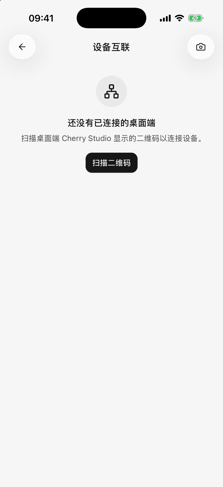

# 从电脑导入配置

如果电脑上的 Cherry Studio 已经配置好模型服务，可以把支持的服务商配置和模型导入手机，减少重复填写地址和密钥。

**本页介绍模型服务商配置与已启用模型的导入，不包含聊天记录。** 配对还可用于[在手机使用电脑智能体](remote-chat.md)，两项功能需要各自的权限。配置不会持续自动同步；需要更新时再主动导入。

## 连接电脑

1. 让手机或平板与电脑连接同一局域网，例如同一家庭 Wi-Fi，并保持桌面端 Cherry Studio 运行。
2. 在桌面端打开 **设备互联**，显示配对二维码。
3. 移动端打开 **设置 → 设备互联 → 扫描二维码**；首次使用允许相机和系统请求的局域网访问权限。
4. 按两端提示完成配对与配置同步授权。设置中的配对完成后，从设备详情主动进入同步；首次使用向导会继续引导导入并选择模型。

不能使用相机时，可以使用页面提供的手动输入方式，粘贴桌面端的配对二维码内容。这里需要的是配对内容，不是普通网页链接。

<figure data-mobile-shot="phone"><figcaption>
<strong>iPhone</strong> · 设置 → 设备互联：扫描电脑端显示的二维码连接
</figcaption></figure>

## 选择并导入服务商

已配对设备可以从设备详情中的 **从桌面端同步模型服务商** 进入；也可以从模型服务列表的更多菜单选择 **从桌面端同步**，再选择来源电脑。

1. 等待读取电脑上已启用的服务商。
2. 勾选本次需要导入的服务商。
3. 阅读“将覆盖所选服务商的地址和密钥，已有模型保留”的提示。
4. 点击同步，查看新增、更新与跳过的数量。
5. 返回对话选择导入的模型；首次使用向导会继续让你选择聊天模型。

## 已在手机上配置过，会发生什么？

| 项目 | 再次同步后的行为 |
| --- | --- |
| 选中的服务商 | 更新为电脑上的配置和密钥，并在手机启用 |
| 电脑已启用、手机缺少的模型 | 添加到手机 |
| 手机上已经存在的同一模型 | 保留手机现有设置，不重复添加 |
| 手机独有的服务商或模型 | 保留 |
| 电脑上已停用的服务商或模型 | 不在本次导入范围内 |
| 聊天记录、插件账号授权 | 不通过此功能导入 |

手机与电脑使用不同密钥时，尤其要注意第一项。即使没有新模型，选择已有服务商同步仍可能替换其地址和密钥。

## 为什么有些服务商不能选？

查看条目上的原因：

* **认证方式不支持**：例如电脑端登录的账号没有可导出的、移动端可用的密钥，需要在手机使用支持的方式单独配置。
* **未配置可用密钥**：需要密钥的服务商应在电脑配置至少一个有效且启用的 API Key；明确无需密钥的 HTTP 网关按导入页面判断。
* **当前版本无法识别配置**：更新移动版，或先跳过该条目，导入其他可用服务商。

0.3.0 可以导入支持的 HTTP 服务配置，包括 LM Studio 等网关及无需密钥的连接。是否能调用还取决于导出的接口：原生 Ollama 接口仍不支持，兼容接口按实际配置处理。

模型仍在电脑或服务所在机器上运行。手机必须能访问导入的地址；`localhost` 和 `127.0.0.1` 在手机上指向手机自身，需改为手机可达的服务地址。配置导入不等于自动转发电脑的网络请求。

## 扫码成功，但同步失败

配对保存的是连接凭据，后续读取配置仍需要连得上电脑。确认桌面端运行、两台设备在同一局域网，且路由器的访客网络隔离、电脑防火墙或代理没有阻断连接。

iPhone 或 iPad 拒绝过局域网权限时，请到系统设置为 Cherry Studio 开启。页面显示“需要重新配对”时，重新扫描电脑端生成的二维码。

## 移除设备会撤销两边的授权吗？

移动端的 **移除设备** 只移除这台手机保存的连接凭据。需要撤销桌面端授权时，还应在电脑的 **设备互联** 中移除这台移动设备。

导入配置不是完整备份。换机前使用[备份与恢复](backup-and-restore.md)保存本机数据；需要单独保存成果时可[分享或导出](sharing-and-export.md)。
