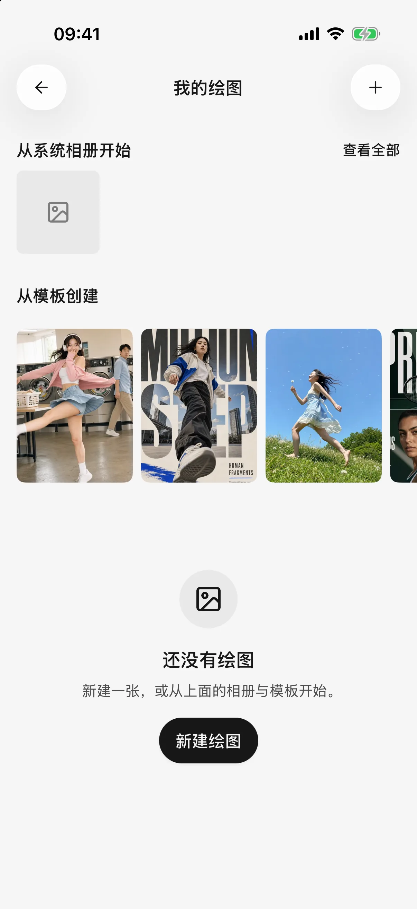
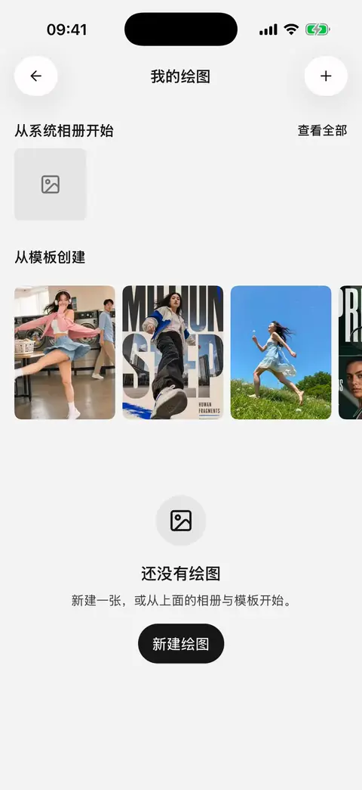
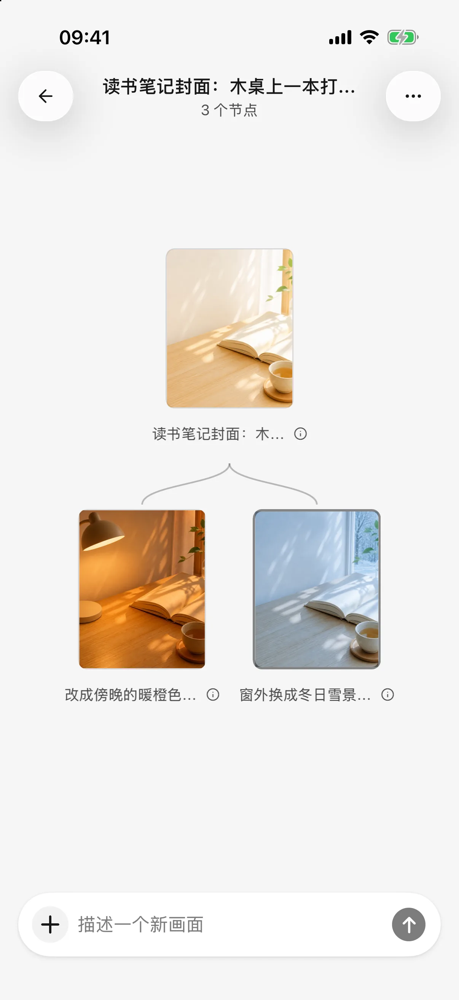

# 图片生成

移动版 **0.3.0** 的独立绘画使用画板保存一次创作中的生成与编辑关系。你可以从文字、参考图或模板开始，再选择某张结果继续修改。先配置图像生成模型；能理解图片的文字模型不一定能生成图片。

## 三种使用方式

| 方式 | 怎么开始 | 结果在哪里 |
| --- | --- | --- |
| 独立绘画 | 侧边栏打开 **绘画**，新建创作、选择照片或使用模板 | 画板中的生成结果，可从绘画列表再次打开 |
| 在对话中直接使用图片模型 | 为标准模式的智能体选择图像生成模型 | 当前对话的图片附件 |
| 让文字智能体调用绘图工具 | 在 **设置 → 默认模型** 选择绘图模型，并开启智能体的图片生成能力 | 当前对话的工具过程和图片 |

第三种方式在每次调用图片工具前要求确认，即使使用自动批准也一样。独立绘画和直接使用图片模型由你点击发送提交。下面的画板操作适用于独立绘画。

## 从一段描述开始

1. 从绘画入口打开新创作。
2. 在输入框的 **＋** 菜单中选择模型并调整生成参数。
3. 描述主体、用途、风格与构图，检查参考图后发送。
4. 等待结果，在大图中查看细节；失败时打开错误详情，再决定重试。

例如：

> 为读书笔记生成横向封面：木桌上有一本打开的书和一杯茶，清晨自然光，暖白和浅木色，左侧留白，不要文字。

首次生成会创建画板。画幅、尺寸、数量等参数由模型决定；更大的图片或更多结果可能增加费用和等待时间。输入框可以展开为大编辑器，适合修改较长描述。

<figure data-mobile-shot="phone"><figcaption>
<strong>iPhone</strong> · 绘画首页：新建绘图，或从相册与模板开始
</figcaption></figure>
<figure data-mobile-shot="phone"><figcaption>
<strong>iPhone 操作演示</strong> · 在 ＋ → 生成设置 中选择绘图模型，描述画面后生成
</figcaption></figure>

## 用模板快速开始

从模板中选择效果，阅读预览和提示词，再选择试用。模板会把文字带入可编辑草稿，不会立即生成，也不会自动把模板预览图作为参考图发送。

修改主体、用途或构图，选择模型并检查参数后再提交。预览是效果示例，不是这次请求的生成结果。

## 在聚焦视图和画板总览间切换

* **聚焦视图**显示当前图片。双指或双击缩放；同次生成有多张图片时可横向切换。
* 点击顶部的画板入口查看**总览**，拖动或缩放查看节点关系，点击缩略图回到对应图片。
* 图片下方的关系条展示来源、当前图片和后续结果；点击切换，长按可临时对比。
* 点击总览中的提示词说明，或从菜单打开生成信息，查看完整描述。画板名称可在总览中修改。

<figure data-mobile-shot="phone"><figcaption>
<strong>iPhone 操作演示</strong> · 在结果上继续修改；切回原图再改一个方向，画板自动分出两条分支
</figcaption></figure>
<figure data-mobile-shot="phone"><figcaption>
<strong>iPhone</strong> · 画板总览：一张原图分出两个修改方向
</figcaption></figure>

## 用参考图继续修改

聚焦的图片会成为下一次生成的参考。提交前检查输入框中的参考图；移除它表示这次不以该图继续。总览中的输入用于开始不引用现有图片的新分支。

> 保留这张图的构图和主体，把背景改成傍晚，其他部分尽量不变。

参考图和编辑是否可用取决于模型。只支持文字生图的模型不能因此获得图片编辑能力；需要参考图的模型必须先提供图片。不要把画板里的所有图片都当作下一次请求的输入。

### 用位置批注说明要改哪里

在大图上长按添加位置批注，选择批注后输入对应要求；切回整图可编辑整体要求。发送时，这些说明随参考图交给模型。

批注是位置和文字提示，**不是精确蒙版**，不能保证模型只改变标记区域。先描述要保留的内容，再检查结果。

支持的模型会提供比例快捷项。选择比例只准备参数或修改要求，不会立即发送；确认输入后仍需主动提交。

## 失败、取消和重复提交

生成期间可以继续浏览画板。查看任务状态再决定下一步；失败结果提供重试和错误详情，之前成功的结果仍可继续使用。停止正在生成的任务会移除该次生成占位。

取消不保证服务商没有处理请求，也不保证退费。模型不支持、参考图不符、余额不足、限流与网络错误应分别处理。

## 保存与分享

从当前图片的菜单保存到相册、分享或查看生成信息。保存相册需要系统授权。删除一个绘画版本与删除文件库中的文件是不同操作，文件和回收站规则见[文件库与共享工作区](file-library.md)。

在 **设置 → 通用设置 → 分享水印** 调整后续导出。聊天中的图片可随所选问答一起导出，详见[分享与导出](sharing-and-export.md)。
