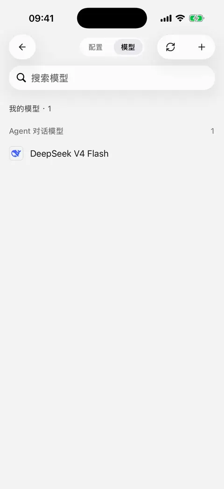

# 模型信息与列表更新

移动版里的“更新”有几种不同含义。看到模型信息更新，并不意味着应用自动换了模型、替你开通了权限，或把新模型都加入了常用列表。

| 想做什么 | 应该怎么操作 | 会改变什么 |
| --- | --- | --- |
| 获取新的模型名称、能力、长度或价格信息 | 打开任意服务商的 **模型** 页 | 刷新应用使用的模型资料 |
| 查看某个平台当前返回哪些模型 | 在该服务商的模型页点击 **同步** | 预览可添加模型与远端未返回的模型，由你选择应用哪些改动 |
| 使用电脑上已配置的服务商 | 选择 **从桌面端同步** | 导入所选服务商配置及缺少的已启用模型 |
| 获取新的应用功能与修复 | 通过官方安装渠道更新 App | 更新应用本身 |

## 模型信息什么时候自动更新？

首次使用时，应用会在后台下载模型资料。没有下载完成时，模型选择、添加或编辑页面可能显示加载或重试提示；先等待下载完成，失败后检查网络并重试。

下载成功后，模型资料会保存在设备上。以后启动应用先使用已保存的资料，不需要每次启动都重新下载。**再次打开服务商的模型页时**，应用会在后台尝试获取更新。

只有成功应用了更新，而且你仍停留在模型页，才会出现 **模型信息已更新** 提示。没有新版本、后台刷新失败，或者已经离开页面，都可能不显示提示；没有提示不一定表示出错。

## 没联网会怎样？

已有模型资料时，刷新失败会继续使用原资料，不会因一次下载失败清空模型配置。首次安装、还没有资料时，需要联网完成第一次下载。

可以离线查看已保存的模型资料，不代表可以离线调用云端模型；发送消息仍需连接所选服务商。

## 我自己编辑的模型信息会被覆盖吗？

远端资料更新不会重写你手动保存的模型改动或自定义模型。没有单独覆盖、仍跟随默认值的字段，才会采用新资料，因此你可能看到默认名称、能力或价格发生变化。

远端模型资料不会修改你的 **API Key、服务商地址或认证配置**，也不会替你启用服务商。若自己改过的长度限制不再合适，可在模型编辑页清空该项并保存，恢复默认取值。

## 如何同步服务商返回的模型列表？

1. 打开 **设置 → 模型服务 → 目标服务商 → 模型**。
2. 等服务商配置保存完成；若正在编辑密钥，先完成密钥弹层的保存，再点击 **同步**。
3. 等待列表加载，查看 **可添加模型** 和 **远端未返回** 两类变化。
4. 勾选本次要处理的条目，然后点击 **更新**。初始没有替你选好改动。
5. 如包含移除操作，阅读确认提示后再决定是否继续。

同步列表不会自动替你启用服务商。同步失败、没有返回模型时，原有模型会保留，可以检查配置后重试，也可以改用[手动添加](model-management.md)。

<figure data-mobile-shot="phone"><figcaption>
<strong>iPhone 操作演示</strong> · 同步模型：搜索并勾选需要的模型，点击更新后加入列表
</figcaption></figure>

## “远端未返回”是不是模型已经下线了？

不一定。不同密钥、账号权限、服务商列表接口和临时故障，都可能影响返回结果。

应用不会因为一次列表结果就自动删除这些模型。只有你选中移除项并确认后才会从应用中移除；聊天记录仍保留，受保护的模型会跳过，具体见[模型删除规则](model-management.md)。不要仅凭“远端未返回”就批量删除正在使用的模型。

## 为什么同步失败，但手动添加后能聊天？

获取模型列表和发送对话使用不同的请求地址。部分平台支持对话，却没有提供模型列表接口，因此同步失败不等于服务不可用。

自定义服务商配置页会单独显示 **模型列表请求地址**。如果平台不支持该地址，可以从平台复制准确的模型 ID，手动添加后检查连接。

## 平台发布了新模型，为什么我还是看不到？

依次确认：

1. 已打开模型页，让模型资料有机会更新。
2. 已向目标服务商同步列表，或手动添加了模型。
3. 当前账号和密钥有该模型的使用权限。
4. 服务商已启用，模型没有停用，选择器筛选已切回“全部”。

模型资料、平台权限和本机已添加的模型是三件不同的事。新模型是否支持当前应用的连接方式，也需要以平台和应用版本为准。
