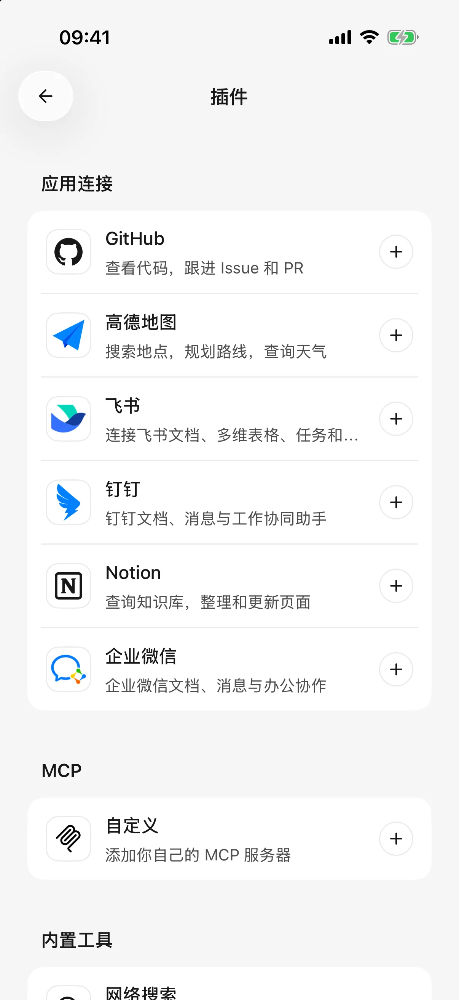

# 插件与外部工具

插件让智能体在你的授权范围内读取或处理其他服务中的资料。例如查阅飞书文档、整理 Notion 页面，或通过高德查询路线。

模型负责理解需求，插件负责访问对应服务。要使用插件，请先选择支持工具调用的文字模型。

## 连接并使用一个插件

1. 从侧边栏打开 **插件**，选择目标服务。
2. 阅读“这个插件能做什么”、示例和权限说明，点击 **连接**。
3. 按页面要求登录授权，或填写对应服务的密钥。
4. 外部页面授权完成后返回 Cherry Studio；需要确认账号或工作区时，继续点击确认，直到显示 **已连接**。
5. 回到对话提出明确需求。也可以点击 **＋ → 插件**，插入目标插件，再补充问题。

例如：“用飞书总结这篇文档的三个结论：[文档链接]。”插件名称会显示在输入框和已发送消息中，方便辨认。

已连接插件可供不同智能体使用，不必给每个智能体重复授权；输入框里的选择用于明确本次需求。没有已连接插件时，输入框不会显示插件入口。

<figure data-mobile-shot="phone"><figcaption>
<strong>iPhone</strong> · 插件页：应用连接、自定义 MCP 和内置工具
</figcaption></figure>

## 常见插件怎样连接？

| 插件 | 适合的任务 | 连接时注意 |
| --- | --- | --- |
| 飞书 | 文档、多维表格、任务与日历 | 按页面准备应用并授权个人账号；企业可能需要管理员审批，当前这里使用飞书账号，不支持国际版 Lark 账号 |
| Notion | 搜索、阅读和编辑页面，维护数据库记录 | 授权工作区后返回确认账号；可访问内容受工作区权限限制 |
| GitHub | 阅读仓库和讨论，管理问题与合并请求 | 可使用应用授权或个人访问令牌；组织仓库可能需要额外批准 |
| 高德地图 | 查地点、周边、天气和路线 | 使用高德开放平台的 **Web 服务 Key**；查询路线不会自动读取手机定位 |
| 钉钉 | 文档、日程、待办及其他办公操作 | 在钉钉授权账号和组织，部分行为还需要单独确认权限 |
| 企业微信 | 在授权范围内处理文档、表格、日程等办公资料 | 把生成的授权链接粘贴到企业微信文件传输助手中打开，完成后返回 Cherry Studio |

功能列表不是账号权限承诺。某个插件支持日历，不代表你的企业一定已开放日历权限；账号套餐、管理员设置和服务配额也可能限制可用能力。

### 飞书应用是什么，怎么准备？

这里的“应用”是飞书侧用于管理授权的配置，不是要再安装一个手机 App。按连接页的 **前往飞书配置应用** 或配置指南链接操作；使用已有应用时，填写 App ID（应用标识）和 App Secret（应用密钥），开通所需的文档、任务或日历权限，再授权个人账号。

### 飞书只有部分功能可用

部分授权成功也可以连接，不必等全部权限都齐全。需要新增能力时，在飞书应用中开通相关权限、完成企业审批，再更新个人授权。只反复重连不会自动获得缺少的权限。

### 钉钉要求额外确认

到钉钉完成该操作的行为授权后，返回对话**重新发起操作**。授权完成不会自动重新执行原来失败的请求。

### 企业微信授权链接过期

链接有效期为 5 分钟。过期时重新生成，并在企业微信内打开；不要仅在普通浏览器里打开后等待。

## 连好以后，可以怎样使用？

以下示例从读取开始。把方括号中的内容换成自己的链接、名称或日期，先检查返回的来源与范围。

| 插件 | 可以直接改写的提问 | 要核对什么 |
| --- | --- | --- |
| 飞书 | “阅读这篇文档：[链接]，列出结论、待办、负责人和截止时间。缺少的信息写待确认，先不要创建任务。” | 文档中的负责人和日期是否明确；创建任务是后续的独立操作 |
| Notion | “阅读这个页面：[链接]，整理最近的项目进展，并保留来源链接。” | 工作区权限；页面或子内容是否读取完整 |
| GitHub | “查看 [仓库地址] 中最近一周的问题讨论，按主题整理，并保留对应链接。” | 仓库可见性、时间范围，以及讨论结论是否已经得到确认 |
| 高德地图 | “查 [城市与起点] 到 [终点] 的公共交通路线，比较步行距离、换乘次数和预计时间。” | 同名地点的城市与地址；预计时间不等于实时发车时间 |
| 钉钉 | “读取这篇钉钉文档：[链接]，总结与 [主题] 有关的内容，先不要修改。” | 所选组织与文档权限；是否还需在钉钉完成行为授权 |
| 企业微信 | “读取这份文档：[链接]，整理其中的三个关键结论并标明来源，先不要修改。” | 授权身份是否能访问该文档，实际连接是否提供相应工具 |

### 从文档整理成真正的任务

例如使用飞书，可以分两次请求：

1. “读取会议纪要：[链接]，列出准备创建的任务、负责人、截止日期。先不要创建。”
2. 核对后再明确要求：“在飞书创建表格中第 1、2 项任务，按刚才确认的负责人和日期设置，其他项先不创建。返回创建结果与链接。”

需要文档读取、人员查找、任务创建等对应能力都可用。负责人同名或日期不明确时先补充信息；不能把聊天里显示的待办表格当作已保存的任务。任务分配、邀请等操作也可能通知对方。

### 读取和修改多维表格或数据库

提供具体表格链接与视图，再说明筛选条件，例如：“只读取这个视图中状态为‘进行中’的记录，列出名称和截止日期，先不要修改。”不要只说“修改我的项目表”，因为可能存在同名表格或多个视图。

需要改动时，先确认具体记录和字段，再要求修改。列表有分页或返回上限时，让智能体说明覆盖范围；一次查询不能默认代表整个数据库。Notion 当前连接不提供附件处理或调用 Notion 智能体的能力。

### 能同时用多个插件吗？

可以在同一任务中配合使用已连接且可用的工具。例如先读取文档，再[保存一份清单文件](file-generation.md)。跨服务复制资料时，明确目的地与要复制的内容，并检查各步骤的结果；一项成功不会使另一项失败自动回滚。

工具确认、结果判断和失败后的处理，见[让 AI 使用工具](using-tools.md)。

## 授权页面关了，为什么还没连上？

关闭浏览器不等于取消授权，也不代表连接已完成。返回插件连接页查看状态，按需使用 **打开授权页面** 或 **已完成，再次检查**，并完成账号确认。

请求过期或被拒绝时重新发起授权。需要切换账号时，按页面提示先断开当前连接，再授权新的账号。

## 断开与撤销授权

在插件详情页打开连接管理或更多菜单，选择 **断开连接**。本机断开后，该插件不再可用。

如果提示“远端撤销尚未确认”，可点击 **管理授权**，到服务商网站撤销。删除本机连接与撤销服务商上的授权不是始终同时完成的。

授权凭据保存在本机，不通过电脑配置同步带到其他设备；另一台手机需要重新连接。插件取回的内容可能交给模型处理，详见[数据、隐私与权限](data-privacy.md)。

## 添加自定义 MCP 工具

**MCP（连接外部工具与服务的协议）**适合已有远程工具服务器地址的用户。移动版 0.3.0 从**侧边栏 → 插件 → MCP 分组 → 自定义**添加服务器。

1. 填写名称和服务方提供的远程地址，优先使用 `https://`。
2. 根据服务要求选择请求头认证或 **OAuth（到服务方登录并授权）**。
3. 请求头按每行 `名称=值` 填写，例如 `Authorization=Bearer 你的令牌`；OAuth 按页面提示保存并完成浏览器授权，返回 App 查看结果。
4. 连接后查看工具列表，停用不需要的工具。
5. 在标准模式智能体的工具区域开启对应服务器，再发送新任务。创建智能体时也可选择已有服务器。

OAuth 服务需要支持移动端回调；部分服务要求公共客户端 ID 或客户端元数据地址，应由服务方提供。使用 OAuth 时不要再手工设置冲突的 Authorization 请求头。失败后按提示重新授权，不要把浏览器关闭当作授权完成。

远程地址不是桌面启动命令，不能把 `npx` 或 `uvx` 命令粘贴到地址栏。0.3.0 的 iOS 客户端支持用户配置的 HTTP 服务，但明文连接仍会提示风险；OAuth 授权端点需要满足其安全要求。

服务器连接、全局工具启用、智能体绑定和标准模式需要同时满足。自动批准不能绕过这些条件。

## 使用提示词、资源和交互式应用

* **提示词**：从输入框的 MCP 提示词入口选择当前智能体可用的条目，填写参数后载入草稿。检查内容再发送，选择模板不等于已经执行任务。
* **资源结果**：工具返回的文件、图片或其他支持的内容可以通过结果入口预览；具体格式由服务提供。
* **MCP Apps（工具返回的可操作界面）**：支持的服务可以展示交互界面。按界面完成操作，仍需满足服务权限和工具规则，并检查结果。
* **服务端表单**：服务需要补充资料时，App 会展示相应交互；阅读请求方和字段后提交或取消。它与系统权限、工具审批分别处理。

不是所有 MCP 服务都提供以上能力。没有提示词或交互界面时，先确认服务器本身是否支持；普通工具调用依然可以正常使用。

## 插件没按要求操作，怎么排查？

先看插件是否显示“已连接”，再看模型是否支持工具调用。给出目标链接、名称、日期范围等信息；如果工具已返回权限错误，到服务商处理权限，而不是更改智能体说明。

对写入任务，可先说“只读取并列出准备修改的内容”，核对后再要求执行。具体是否出现确认提示由[工具审批方式](agents-and-tools.md)决定。
