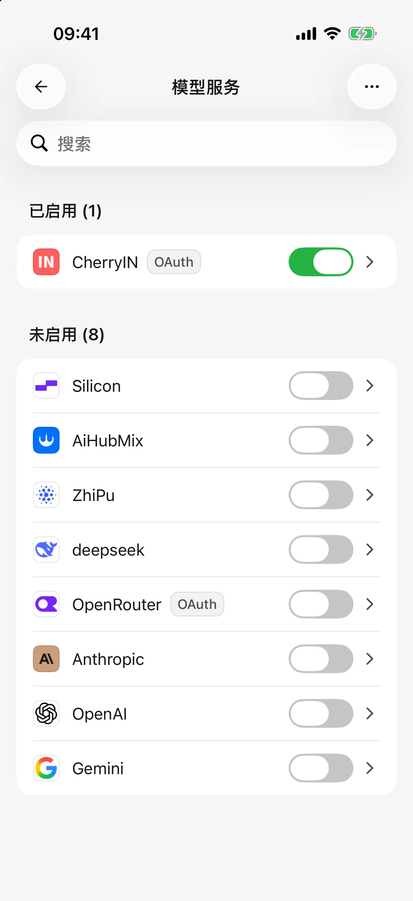
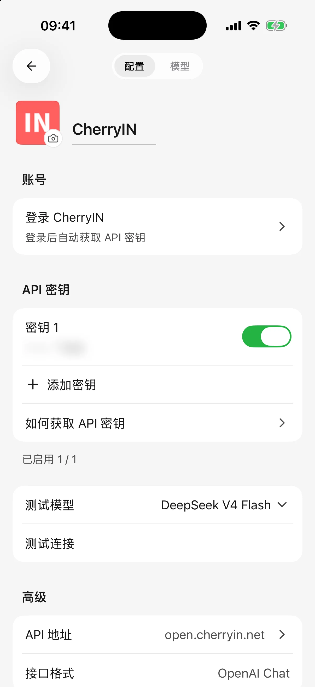
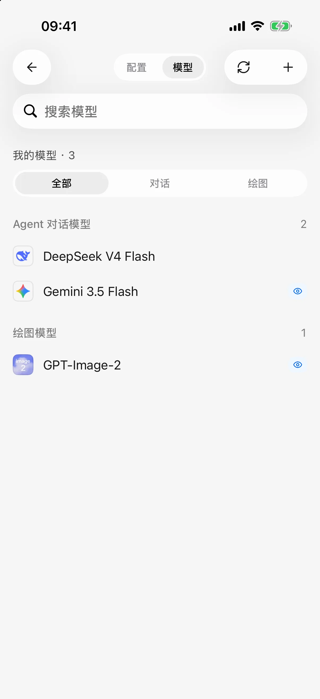

# 服务商与模型

服务商是提供 AI 服务的平台，模型是你在这个平台上使用的具体 AI。同一模型可能由不同平台提供，需要使用对应平台的凭据。本文按移动版 **0.3.0** 整理。

初次使用可以填写 **API Key（服务商提供的调用密钥）**，或使用配置页实际提供的账号登录方式。Cherry Studio 不附带模型额度；账号支持哪些模型、如何计费，以对应平台为准。

## 添加内置服务商

1. 打开 **设置 → 模型服务**，点击添加按钮。
2. 搜索目标服务商，点击 **添加**。
3. 按配置页填写密钥，或通过账号区域登录授权；内置地址和接口通常可保持默认。
4. 按页面继续添加模型：同步列表并勾选，或手动填写平台提供的模型 ID。
5. 回到模型服务列表，确认服务商已启用，再去对话选择模型。

已添加的服务商直接打开编辑即可，不必重复创建。创建新服务商需要完成页面的继续或创建操作；编辑已经保存的服务商则按下文自动保存。

<figure data-mobile-shot="phone"><figcaption>
<strong>iPhone</strong> · 模型服务列表：已启用的服务商排在前面
</figcaption></figure>
<figure data-mobile-shot="phone"><figcaption>
<strong>iPhone</strong> · 服务商配置页：账号登录、多密钥、测试连接和接口地址（密钥已打码）
</figcaption></figure>

## 添加自定义服务商

1. 在添加页面选择 **自定义服务商**，填写名称。
2. 按平台说明选择接口。OpenAI、Anthropic、Gemini 等选项表示连接格式，不是随意替换的模型名称。
3. 填写 **Base URL（应用连接服务的基础地址）**及服务要求的凭据。
4. 核对地址和接口，继续创建，再同步或手动添加模型。
5. 确认服务商已启用，选择一个模型进行连接检查。

### Base URL 应该填什么？

使用服务商给出的基础地址，例如 `https://api.example.com/v1`。不要填写登录页或控制台地址，也不要把 `/chat/completions` 等完整请求路径重复放入基础地址。

少数平台要求不自动追加版本号，可按其要求在末尾加 `#`，例如 `https://api.example.com#`。不需要时不要添加。支持多种接口的服务商可以分别管理地址并选择默认接口；修改默认接口可能影响跟随它的模型，应阅读确认提示。

连接电脑上的 HTTP 服务时，手机必须能访问该地址。`localhost` 或 `127.0.0.1` 在手机上指向手机自身；导入电脑配置不会自动让这些地址可达。无需密钥的网关仅在配置明确支持时可用，不要为了绕过配置提示随意填写假密钥。详见[电脑配置导入](desktop-sync.md)。

## 编辑服务商与管理多个密钥

**已有服务商的配置会直接保存，没有统一的页面“保存”按钮。** 名称、地址和密钥开关按各自操作保存；出现错误时处理后再离开。

* 每个密钥单独添加，可以分别启用、停用和删除；不要把多个密钥粘贴到同一个输入框。
* 打开密钥编辑弹层后，修改密钥或备注需要点击该弹层的 **保存**；这与服务商页面的自动保存不同。
* 备注只用于区分用途，不改变额度或权限。
* 使用密钥认证的服务商需要至少一个有效且启用的密钥；账号认证或明确无需密钥的连接按其配置要求处理。

部分对话请求会在认证或限流错误时尝试其他启用密钥。不要把它当作增加额度或对所有请求均保证成功的机制。

## 使用账号登录

配置页提供登录入口时，按提示打开授权页面，登录后返回 Cherry Studio 完成确认。并非目录中的每个服务商都支持账号登录，也不能把任意平台的聊天会员直接作为接口额度使用。

账号区域可显示平台提供的身份、余额或刷新入口。退出登录和撤销模型密钥不一定是同一件事；需要停用某个密钥时，检查密钥列表。换设备或恢复备份后，相关账号可能需要重新登录。

## 检查连接

在服务商配置中选择用于检查的文字模型并执行连接检查。先处理未完成的密钥弹层或保存错误，再发起检查。

成功表示这次配置与所选模型可用，不代表所有模型都能调用。检查不会自动启用服务商；仍需确认列表中的启用状态。模型同步与对话使用不同接口，同步失败时可以手动添加模型后检查。

## 从哪里选择模型？

对话中的模型选择器更改当前智能体使用的模型。可搜索并使用 **全部、免费、视觉** 等筛选；找不到模型时先清除筛选，检查服务商与模型是否启用。

“视觉”和“免费”来自模型资料，实际能力、免费范围和额度以服务商为准。手动改变能力标记不能让模型获得原本没有的能力。

在 **设置 → 默认模型** 中可以设置默认文字模型、绘图模型和翻译模型。已有智能体保留自己的选择，默认模型不会批量覆盖它们。翻译的回退规则见[回复与技能文档翻译](translation.md)。

<figure data-mobile-shot="phone"><figcaption>
<strong>iPhone</strong> · 服务商的模型页：同步模型或手动添加，视觉模型会带标记
</figcaption></figure>

## 接下来阅读

* [添加、编辑与管理模型](model-management.md)：能力、长度、价格与删除规则。
* [模型信息与列表更新](model-updates.md)：资料更新与手动同步的区别。
* [从电脑导入配置](desktop-sync.md)：复用已有服务商。
* [常见问题](troubleshooting.md)：连接错误与恢复。
