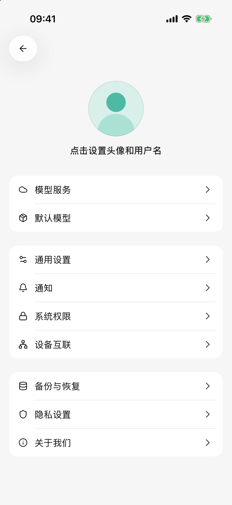
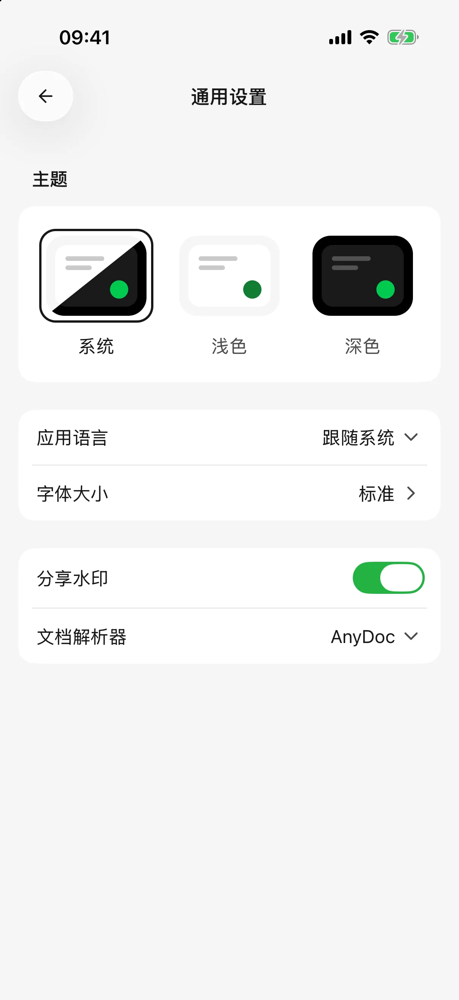
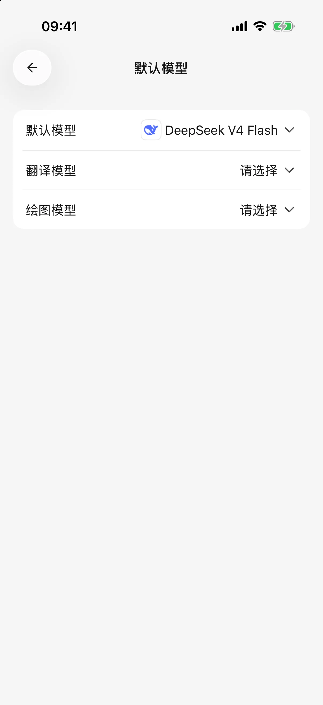
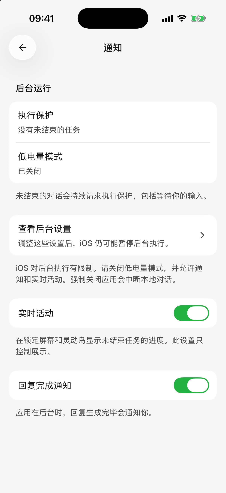

# 设置、用量与后台回复

常用设置集中在侧边栏的设置入口。想改善阅读体验、选择默认模型或处理后台任务，可以从这里调整。

## 主题、语言与字号

在 **设置 → 通用设置** 中：

* 选择浅色、深色或跟随系统的主题。
* 选择应用语言；应用界面语言与正在阅读的官网文档语言分别设置。
* 打开字体大小，按预览选择适合阅读的字号。
* 开启或关闭分享水印，控制后续导出的品牌页脚。

这些选项更改后直接保存。如果看到保存失败提示，重试后再离开。

<figure data-mobile-shot="phone"><figcaption>
<strong>iPhone</strong> · 设置首页
</figcaption></figure>
<figure data-mobile-shot="phone"><figcaption>
<strong>iPhone</strong> · 通用设置：主题、语言、字号、分享水印和文档解析器
</figcaption></figure>

## 默认模型与绘图模型

在 **设置 → 默认模型** 中选择：

* **默认模型**：为新建智能体提供默认的文字模型选择。
* **绘图模型**：用于默认绘图及文字智能体的图片生成工具。
* **翻译模型**：用于回复和技能文档翻译；未设置时使用默认文字模型，详见[翻译教程](translation.md)。

选择或清除会立即保存，不需要另找保存按钮。已有智能体仍保留自己的模型；切换某个智能体时，到它的编辑页或对话模型选择器修改。

模型列表为空时，先到模型服务中添加可用模型并启用服务商。模型的编辑、能力标记和价格设置见[模型管理](model-management.md)。

<figure data-mobile-shot="phone"><figcaption>
<strong>iPhone</strong> · 默认模型、翻译模型和绘图模型分别设置
</figcaption></figure>

## 查看用了多少模型额度

从侧边栏进入首页，查看 **AI 用量**，点击查看详情可阅读按日期、模型或服务商整理的记录。

对话中也可以打开回答的用量详情，查看该次回答的模型、输入和输出量、请求次数、生成耗时及费用信息。**Token（模型计算内容长度的单位）**不等于字数，历史对话、思考和工具往返也可能计入消耗。

理解费用时留意：

* 服务商返回的计费金额与根据模型价格估算的金额，来源可能不同；查看页面标注。
* 缺少价格时，统计可能只有部分费用，不能把未显示金额当作免费。
* 重新回答或多次调用工具可能产生额外请求。删除对话不会退回已经使用的额度，也不会抹去已经发生的用量记录。
* 此处反映本应用已记录的使用情况，不是整个服务商账户的余额或正式账单。

实际账单与剩余额度请到服务商账户查看。

## 离开应用后继续生成

打开 **设置 → 通知**：

| 选项 | 用途 |
| --- | --- |
| iPhone / iPad：实时活动 | 离开应用后，在支持的锁定屏幕或灵动岛上展示任务状态 |
| Android：后台回复 | 尝试继续处理回复，并通过通知显示状态 |
| 回复完成通知 | 应用在后台完成回复时，尝试发送完成通知 |

进度展示和完成通知是不同选项。还需要系统允许 Cherry Studio 发送通知；关闭系统权限后，仅在应用中打开开关不能保证收到提醒。点击任务通知可回到相应内容。

当前页面正显示任务时，完成通常不会额外弹出通知。实时活动也主要在离开应用后出现，前台看不到不一定是设置失效。

<figure data-mobile-shot="phone"><figcaption>
<strong>iPhone</strong> · 通知页：后台运行状态、实时活动和回复完成通知
</figcaption></figure>

## 锁屏后为什么还是中断？

后台回复不是持续运行保证。系统的省电策略、后台限制、网络断开或清理进程，仍可能让任务停止。较长的生成任务尽量保持应用在前台。

模型连接中途断开时，应用可能自动重试并显示状态；待发送消息队列也可在重新打开后恢复。系统强制结束进程时仍以已保存的内容为准。先检查当前回复、重试和队列状态，再决定是否重新回答，避免重复提交；绘图检查任务记录后再生成。

iOS 的后台执行时间有限，实时活动只负责展示状态，不保证任务一直运行。远程电脑上的任务不因手机断连而自动停止，见[远程聊天](remote-chat.md)。

等待工具批准时，任务也可能停在审批步骤。回到应用完成确认后才能继续。通知未送达时，仍可在应用内查看任务状态。

## 文档解析、备份与反馈

* **设置 → 通用设置 → 文档解析器**：选择后续文档提取方式，见[对话与文件](chat-and-files.md)。
* **设置 → 备份与恢复**：创建完整备份或替换恢复，见[备份教程](backup-and-restore.md)。
* **设置 → 关于**：查看版本、意见反馈与反馈记录；提交后可复制报告 ID、查询处理进度。摇一摇反馈需先开启，截图是否上传按每次提交的选择决定。

## 隐私与系统权限

**设置 → 隐私设置** 中的共享匿名使用数据、匿名错误报告分别控制不同用途；**设置 → 系统权限** 控制相机、照片、日历等系统能力。二者不互相代替。

完整说明见[数据、隐私与权限](data-privacy.md)。
