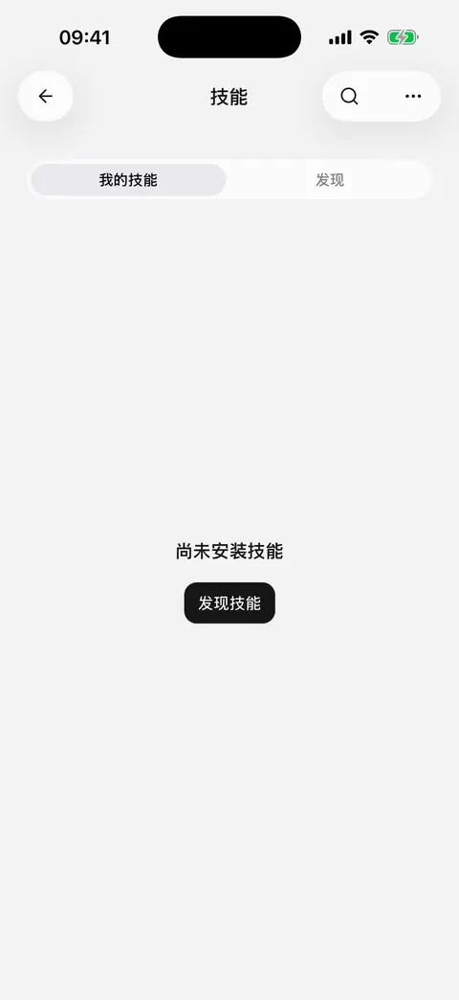
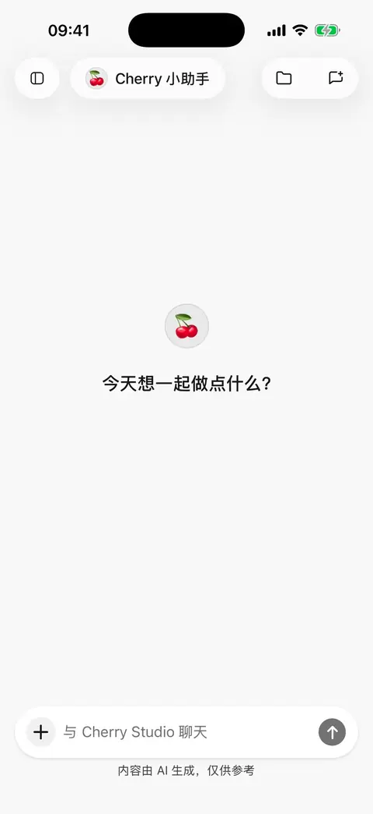

# 技能：安装与复用任务流程

Skills（技能）把一类任务的说明、步骤和参考材料打包保存，供智能体反复使用。例如固定格式的调研报告、会议纪要或写作流程。本文按移动版 **0.3.0** 整理。

技能提供做事的方法；模型、插件和系统权限决定实际能做什么。安装技能不会自动连接账号、授予权限，也不会让手机运行电脑上的命令。

## 从技能库开始

1. 从侧边栏打开 **技能**，切换到 **发现技能**。
2. 搜索要完成的任务，打开技能详情，阅读说明和能力限制。
3. 点击 **安装**。一个来源包含多个技能时，先选择需要的条目。
4. 返回已安装列表，打开技能查看完整说明。

发现页默认展示 CherryIN 标记为支持移动端的技能，也可以选择其他提供的来源。这里的移动端标记不代表你的模型、账号和权限已经配置好。

<figure data-mobile-shot="phone"><figcaption>
<strong>iPhone 操作演示</strong> · 技能 → 发现 → 打开详情 → 安装
</figcaption></figure>

## 从链接安装，或让 AI 帮忙找

在技能页的更多菜单选择 **在对话中添加**，再输入任务需求或公开的 skills.sh / GitHub 技能链接。例如：

> 帮我找一个把会议纪要整理成行动清单的技能，说明需要哪些工具，再让我选择安装。

> 安装这个公开仓库里的技能：[链接]。如果有多个技能，先列出名称和用途。

按对话中的候选结果完成选择与安装。仓库需要公开可访问，普通网页或私有仓库链接不一定能作为技能来源。安装失败时保留错误提示，检查链接、网络及包格式。

## 给智能体启用技能

1. 打开目标智能体的编辑页，使用 **标准** 模式。
2. 在技能区域启用已安装的技能。
3. 回到对话描述任务；也可以从输入框的技能入口明确引用它。

**启用**表示智能体可以在合适的时候选择该技能；**在消息中引用**表示这次明确要按它的方法做。技能安装在全局技能库中，各智能体的启用情况分别保存。极简模式不使用技能，详见[智能体与工具](agents-and-tools.md)。

<figure data-mobile-shot="phone"><figcaption>
<strong>iPhone 操作演示</strong> · 在智能体编辑页的技能区域启用已安装技能
</figcaption></figure>
<figure data-mobile-shot="phone"><figcaption>
<strong>iPhone 操作演示</strong> · 在输入框的 ＋ → 技能 中引用，本次回答按该技能执行
</figcaption></figure>

## 把自己的方法保存成技能

在技能页选择创建技能，或在对话里说明想复用的流程：

> 把我们刚才整理周报的方法做成技能：先读取我提供的材料，再按进展、风险、下周计划输出。缺少的信息先问我，不要编造。先给我看完整内容，再保存。

检查拟保存的名称、说明和完整步骤，再按提示确认保存，以及是否为当前智能体启用。试用时先处理一份简单材料，确认输出符合预期后再用于正式任务。

## 阅读、翻译和更新

* 详情页可以阅读完整技能文档；使用 **AI 翻译** 选择目标语言，完成后可切回原文。翻译帮助阅读，不会修改技能原文或智能体收到的指令。
* 已完成的译文会保存在本机，再次阅读不需要重复请求。技能内容更新后，需要针对新内容重新翻译。模型设置见[回复与技能文档翻译](translation.md)。
* 使用更新入口检查或应用来源更新。更新会使用上游内容；改过本地说明时，更新前先保留需要的内容。
* 卸载会将该技能从所有智能体移除，已经生成的文件仍留在文件库。

## 为什么装好了，却不能完成任务？

| 现象 | 处理方式 |
| --- | --- |
| 技能要求读取飞书等服务 | 先连接[对应插件](plugins.md)，并确保账号有目标资料的权限 |
| 技能需要搜索、日历或图片生成 | 在智能体中开启相应能力，并完成模型、服务和系统权限配置 |
| 提示包含脚本或缺少工具 | 移动版不执行技能包附带的脚本；查看哪些步骤能在当前 App 完成 |
| 已安装，但输入框找不到 | 检查当前智能体是否启用该技能、是否使用标准模式，以及技能是否允许手动引用 |
| 需要调整技能以适应手机 | 让智能体提出具体修改，阅读完整改动后再确认保存本地说明 |

技能不能扩大工具权限，也不能改变[工具审批方式](using-tools.md)。代码计算工具只运行模型为当前任务编写的受限代码，不等于可以执行技能包里的任意程序。
