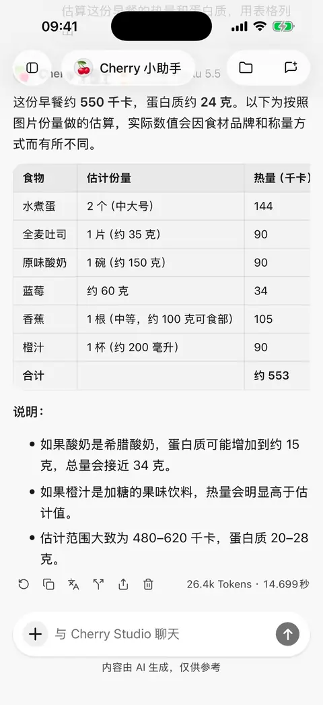

# 回复与技能文档翻译

移动版 **0.3.0** 可以翻译本机智能体的完整回复，以及技能库中的文档。译文用于阅读和分享，不会替换原消息，也不会改写技能指令。

## 选择翻译模型

在 **设置 → 默认模型** 中选择 **翻译模型**。未单独设置时使用默认文字模型；明确选过的翻译模型被删除或不可用时，需要重新选择，不会悄悄换成其他模型。

翻译会把原文发送给所选模型服务，可能产生模型费用。使用账号登录的服务商时，需保持该账号可用。翻译不需要智能体调用搜索或插件。

## 翻译一条回复

1. 在本机智能体对话中，等待文字回复完成。
2. 点击回答工具栏的翻译按钮，选择目标语言。关闭语言菜单不会发起请求。
3. 在原回答下方阅读译文；生成期间可以取消，失败后可以重试。
4. 使用译文下方的语言入口切换目标语言，或复制当前译文。原工具栏的翻译按钮用于展开或收起译文。

每条回复分别保存语言选择。已完成的多种语言结果可在重启后继续读取；切回已有译文不会再次调用模型。应用界面语言变更不会自动改变译文语言。

只翻译完成且成功的回答正文和其中的代码内容，不包含思考过程、工具结果或错误消息。远程电脑会话当前没有消息翻译入口。

<figure data-mobile-shot="phone"><figcaption>
<strong>iPhone 操作演示</strong> · 点击回复下方的翻译按钮并选择语言，译文显示在原文下方
</figcaption></figure>

## 分享时包含译文

先展开希望分享的译文并选好语言，再从**原消息的分享入口**进入消息选择与预览。选中原消息后，图片、HTML 和 Markdown 导出会附带进入分享时展开的译文。

收起的译文不会导出，即使它已保存在本机。译文是否包含与“包含思考内容”开关无关。详见[分享与导出](sharing-and-export.md)。

## 翻译技能文档

1. 在[技能库](skills.md)打开已安装、待安装或发现页中的技能文档。
2. 点击 **AI 翻译**，选择目标语言。
3. 完成后使用同一入口在原文与已保存译文间切换。

重开文档时先显示原文，已有译文可直接读取。技能内容更新后，旧译文不会作为新文档的翻译继续使用。阅读译文不会改变技能的安装内容或智能体实际执行的说明。

## 为什么没有译文，或需要重新翻译？

| 现象 | 原因与处理 |
| --- | --- |
| 找不到翻译按钮 | 确认是本机智能体已完成的文字回答；远程会话和未完成回答不提供此入口 |
| 提示模型不可用 | 检查翻译模型、服务商启用状态、密钥或登录账号 |
| 离开页面后没有保存结果 | 未完成、被取消、截断或失败的译文不会当作成功结果保存 |
| 重新回答后旧译文消失 | 原文改变后需要重新翻译，避免把旧译文配给新内容 |
| 内容很多，翻译中断 | 检查模型输出能力；可将材料分段处理，不要把截断结果当作完整译文 |

关键名称、数字、代码和专业用语仍应与原文核对。
