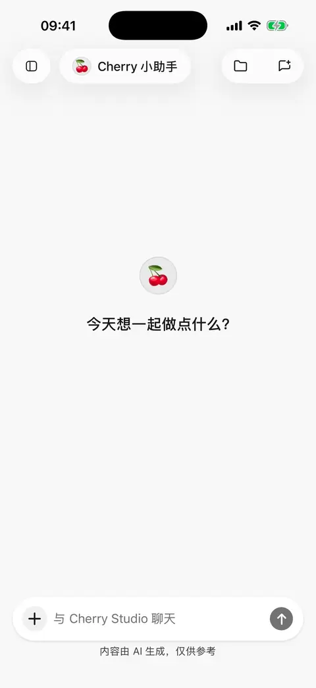

# 联网搜索与网页阅读

搜索用于找相关页面，网页阅读用于提取指定链接的正文。移动版 **0.3.0** 可以使用模型服务商自带的联网能力，也可以调用单独配置的搜索和阅读服务。

## 先试一次搜索

1. 打开当前智能体编辑页，在标准模式下开启 **网络搜索**。需要极简模式时，开启后再切换模式。
2. 选择支持相应联网方式的模型，发送“搜索这个项目近期的更新，并附上来源”，或“阅读这个链接，整理三个要点：[链接]”。
3. 查看回答中的联网过程和来源，打开原网页核对。

输入框没有独立的联网搜索开关。开启能力表示允许使用，不代表每条消息都会搜索；是否确实联网应看工具过程和来源。

<figure data-mobile-shot="phone"><figcaption>
<strong>iPhone 操作演示</strong> · 让 AI 联网搜索并附来源，点击“来源”查看引用的网页
</figcaption></figure>

## 模型自带联网与外部服务怎么选？

| 方式 | 何时适用 | 需要准备 |
| --- | --- | --- |
| 模型自带联网 | 所选模型、接口和认证方式支持服务商执行搜索或网页读取 | 可用的模型连接与智能体网络搜索开关 |
| 外部搜索与阅读 | 希望指定服务，或模型缺少相应联网能力 | 支持工具调用的文字模型，以及可用的搜索/阅读服务 |

在 **插件 → 内置工具 → 网络搜索 / 网页读取** 配置联网来源偏好及外部服务。新安装默认优先可用的模型自带能力；已有用户可能保留之前的外部服务优先设置。

标准模式会在请求开始前根据偏好和可用性选择路径；搜索和网页读取可能使用不同来源。失败后不会自动轮流尝试其他服务。**极简模式只使用可用的模型自带联网，不调用外部搜索工具。** 选择极简模式后不能搜索时，应检查模型支持情况，或切回标准模式。

支持情况取决于具体模型、接口和登录方式，不能仅凭服务商品牌判断。手动勾选能力标记也不会让服务端提供原本不存在的联网能力。

## 更换搜索或网页阅读服务

1. 从侧边栏打开 **插件**，在内置工具中进入 **网络搜索** 或 **网页读取**。
2. 选择服务商，按页面填写密钥、地址等配置。搜索和读取可以分别选择。
3. 使用 **检查** 确认配置，再回到对话发送新问题。

页面上的选项按各自操作保存；服务配置表单若提供 **保存**，应提交后再检查。模型平台密钥与搜索服务密钥通常不同，智谱等共享模型凭据的服务按页面指引配置。

外部服务的初始选择仍是 Exa MCP 搜索与 Jina 网页读取，通常无需先填个人密钥；这不代表每次联网都会走它们。可选服务还包括需要密钥的搜索平台、自托管的 SearXNG、Crawl4AI，以及 Querit 等，以页面列表和配置要求为准。

## 本地网页提取是什么？

选择本地网页提取时，由手机直接请求网页并提取正文，无需额外的提取服务密钥。得到的正文仍会交给对话模型处理，所以“本地提取”不代表整个问答离线，也不代表内容不会发往模型服务商。

它适合可直接访问的公开网页。依赖复杂脚本、登录态或访问验证的网站可能无法读取，手机网络也必须能连接目标网站。

## 高级设置需要改吗？

初次使用保留默认即可。外部搜索效果有明确问题时，再调整结果数量、正文压缩和正文总量。更多结果可能增加资料覆盖，也会增加模型用量；较小的正文上限可能遗漏后面的内容。

网页读取也有内容上限。需要精确核对时打开原网页；重复读取不保证自动接着读上次被截断的后半部分。

## 为什么模型能聊天，却不能搜索？

1. 检查当前智能体是否开启网络搜索，是否处于极简模式。
2. 使用模型自带联网时，检查具体模型、接口与账号是否支持。
3. 使用外部服务时，检查模型工具调用能力、服务配置和检查结果。
4. 阅读错误详情，分别处理网络、密钥、权限、额度或网页限制。

对话连接可用不代表搜索服务和目标网页也可达。外部联网失败后，本轮会停止新的外部联网尝试并尽量使用已有材料；修复后发一条新消息再试。

## 为什么无法读取登录后的网页？

外部阅读服务不会自动带上手机浏览器中的登录状态，本地提取也不等同于在已登录浏览器里打开页面。

飞书、Notion 等账号中的资料优先使用[对应插件](plugins.md)；也可以导出自己有权使用的内容，按[对话与文件](chat-and-files.md)添加。

## 数据会发给谁？

外部搜索接收关键词，阅读服务接收目标链接；模型自带联网由所选模型服务处理。本地提取直接访问目标网页，提取结果再参与模型回答。不要将密钥或不需要检索的私人内容放入关键词。详见[数据、隐私与权限](data-privacy.md)。
