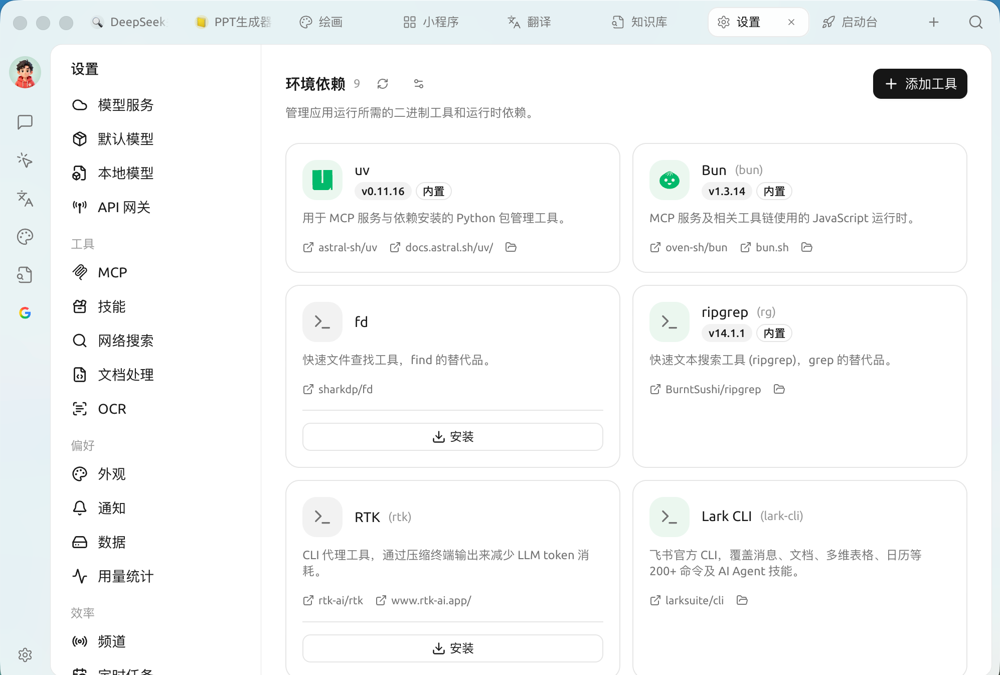

# 环境依赖

环境依赖用来 **管理 Cherry Studio 运行部分高级功能所需的二进制工具和运行时**。像 [MCP 服务](../../advanced-basic/extensions/mcp/)、[技能](../../advanced-basic/extensions/skills.md)、[智能体](../../advanced-basic/agent.md) 的一些能力，底层要调用 `uv`、`bun` 等命令行工具。Cherry Studio 把它们集中在这里，让你不必手动去命令行安装配置。

打开 `设置 → 环境依赖`：

<figure><figcaption>
环境依赖：内置与可安装的工具
</figcaption></figure>

### 内置与可安装

每个工具以卡片形式展示，并标注状态：

* 标有 <mark style="color:blue;">**内置**</mark> 的工具随 Cherry Studio 一起分发，开箱即用，无需操作。
* 未安装的工具卡片上会出现 **安装** 按钮，点击即可由 Cherry Studio 自动下载安装到应用目录，不污染你的系统环境。
* 卡片上提供源码仓库、官方文档链接，以及打开本地安装目录的入口。

常见工具一览：

| 工具 | 作用 |
| --- | --- |
| **uv** | 用于 MCP 服务与依赖安装的 Python 包管理工具 |
| **Bun** | MCP 服务及相关工具链使用的 JavaScript 运行时 |
| **fd** | 快速文件查找工具，`find` 的替代品 |
| **ripgrep (rg)** | 快速文本搜索工具，`grep` 的替代品 |
| **RTK** | 压缩终端输出、减少 LLM token 消耗的 CLI 代理工具 |
| **Lark CLI** | 飞书官方 CLI，覆盖消息 / 文档 / 多维表格 / 日历等 200+ 命令 |

页面还以卡片列出 `gh`（GitHub CLI）、`ntn`（Notion CLI）、`pi` 等工具，可按需一键安装。（编程类 CLI 如 Claude Code / Codex 在 [编码搭档](../../cherrystudio/preview/code-cli.md) 页管理，不在此页。）

### 添加工具

页面右上角的「**添加工具**」可用 mise 工具键，加入内置清单以外的工具（例如 `github:sharkdp/fd`、`uv`、`bun`）。

### 高级安装设置

点右上角的设置图标打开「**高级安装设置**」，微调工具的下载方式（字段均可留空用默认）：

* **GitHub 镜像**：给 GitHub Release 下载加代理前缀（如 `https://ghfast.top`），直连不畅时用。
* **GitHub 令牌**：提高工具查询时的 GitHub API 速率限制（明文保存在本地）。
* **npm 镜像源 / pip 索引地址**：给 `npm:` / `pipx:` 类工具设镜像（留空则在中国大陆自动选镜像）。
* **校验工具签名**：校验工具的 Sigstore / SLSA 签名，一般保持开启。


普通用户一般无需在这里操作——需要某个工具时，相关功能（如安装某个 MCP 服务）通常会引导你回到这里一键安装。这个页面更像是一个"运行环境体检与补齐"的入口。



如果某个 MCP 服务或技能报错提示"找不到 uv / bun / 命令不存在"，先来这里确认对应工具是否已安装或为"内置"状态（安装状态会自动刷新；右上角那个按钮是 **检查更新**，用于拉取工具的最新版本）。


***

### 获取帮助与提交反馈

如果您在配置或使用过程中遇到任何疑问、Bug 或有功能改进建议，请参考 [反馈与建议](../../question-contact/suggestions.md) 中提供的官方渠道。
