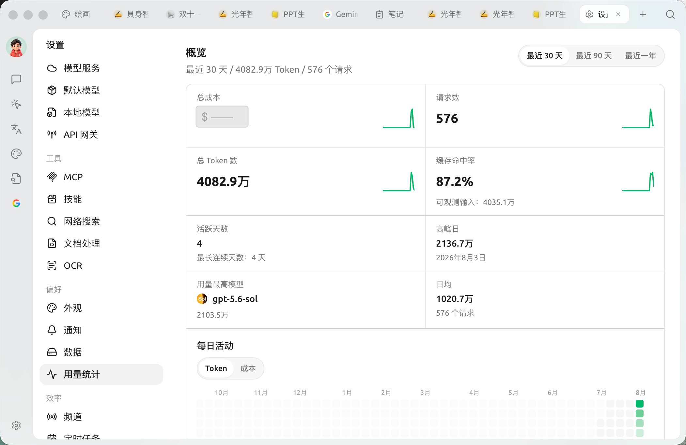

# 用量统计

用量统计把你在 Cherry Studio 里的 **模型调用情况汇总成可视化面板**：花了多少钱、用了多少 Token、发了多少请求、哪个模型用得最多，一目了然。它帮你估算成本、发现异常消耗，也方便对不同模型的使用做取舍。

打开 `设置 → 用量统计`。页面分 **概览 / 探索 / 请求** 三块，右上角可切换 **最近 30 天 / 最近 90 天 / 最近一年**，所有数据按所选区间统计。

<figure><figcaption>
用量统计【概览】：顶部指标卡 + 下方每日活动热力图（图中总成本已隐去）
</figcaption></figure>

### 概览

顶部一组指标卡：

| 指标 | 含义 |
| --- | --- |
| **总成本** | 区间内的估算花费（按各模型公开定价折算，仅供参考） |
| **请求数** | 发起的请求总次数 |
| **总 Token 数** | 输入 + 输出的 Token 总量 |
| **缓存命中率** | 命中提示词缓存的比例（命中的缓存读取 ÷ 可观测输入），越高越省钱 |
| **活跃天数 / 最长连续天数** | 有使用记录的天数与连续使用的天数 |
| **高峰日** | 单日用量最高的日期及其 Token 量 |
| **用量最高模型** | 区间内消耗最多的模型 |
| **日均** | 平均每天的 Token 量与请求数 |

下方的 **每日活动** 热力图按天展示用量强度，可在 **Token / 成本** 两个维度间切换，颜色越深代表当天用得越多。

### 探索 / 分析

切到 **探索** 可对用量做拆分分析：按 **分组**（供应商 / 模型 / API 密钥 / 助手·智能体）拆开，选一个 **指标**，再用 **柱状图 / 折线图 / 饼图 / 分段** 等图表查看分布与趋势。

### 请求明细

**请求** 列出逐条请求记录，便于定位是哪些请求产生了主要消耗。

> 想按某天看？在概览的 **每日活动** 热力图上点选某一天，探索区（分析 + 请求）会 **下钻** 到当天、标题变为"某日 明细"；点「清除日期筛选」返回。


成本为 **估算值**：它按模型的公开定价折算，实际计费仍以各模型服务商的账单为准。免费模型、本地模型不产生费用。


***

### 获取帮助与提交反馈

如果您在配置或使用过程中遇到任何疑问、Bug 或有功能改进建议，请参考 [反馈与建议](../../question-contact/suggestions.md) 中提供的官方渠道。
