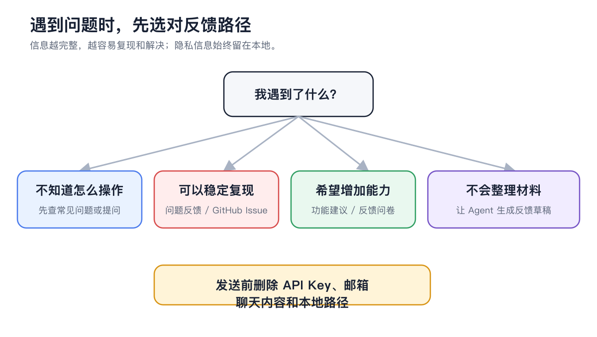

# 如何高效提问

一个容易回答的问题，不一定很长，但要让别人知道你在做什么、实际发生了什么，以及怎样才能看到同样的问题。

<figure><figcaption><p>先判断是使用疑问、可复现问题还是功能建议，再准备对应材料。</p></figcaption></figure>

### 先选合适入口

| 你的情况 | 推荐入口 |
| ------------ | ----------------------------- |
| 不确定是配置还是产品问题 | 侧栏【帮助】→【问题反馈】→【求助问题反馈助手】 |
| 已确认是可复现缺陷 | GitHub Bug Report |
| 希望增加新能力 | GitHub Feature Request |
| 讨论用法或方案 | GitHub Discussion / Questions |
| 只需要查操作步骤 | 当前文档与 Cherry Assistant |

Cherry Assistant 可以读取当前安装包信息，并在你同意后收集必要诊断。它会先展示脱敏后的预览，再提交反馈或生成诊断包；不需要你先学会看日志。

### 问题应包含什么



#### 1. 一句话说明目标

例如：“我想让智能体在工作日早上把日报发到飞书群。”



#### 2. 写出实际结果和期望结果

实际结果：“任务运行成功，但飞书没有收到消息。”期望结果：“运行完成后，指定群收到一条日报。”



#### 3. 提供最短复现步骤

从能稳定出现问题的入口开始，用 3–6 步写清点击路径、选择内容和错误出现位置。



#### 4. 补充环境

写明操作系统、【设置】→【关于我们】中显示的版本、相关服务商或频道类型。不要公开 API Key 和账号凭据。



#### 5. 添加截图、录屏或日志

截图要包含错误和所在页面；日志只截相关时间段并先脱敏。模型输出问题应附上输入、模型和期望格式。



### 可直接使用的模板

```
标题：智能体定时任务运行成功，但飞书频道没有收到结果

目标：工作日 09:00 把运营日报发送到指定飞书群。
实际结果：运行历史显示成功，飞书无消息。
期望结果：群内收到一条日报消息。

复现步骤：
1. 打开【设置】→【定时任务】。
2. 选择日报任务并点击【运行】。
3. 等待任务完成。
4. 查看飞书群，没有新消息。

环境：macOS / Cherry Studio【关于我们】中显示的版本 / 飞书频道。
已经尝试：重新启用频道；在飞书中给机器人发送测试消息。
附件：已遮挡凭据的频道状态截图、对应运行记录。
```

### 截图和日志要删掉什么


提交前删除 API Key、Authorization、Cookie、机器人 Token、App Secret、邮箱、完整本地路径、聊天内容和业务数据。密钥一旦公开，应立即到服务商或平台撤销。


### 让排查更快的小习惯

* 每次只复现一个问题；
* 使用能出现问题的最小配置；
* 说明问题是否稳定发生；
* 不只写“不能用”，附上错误原文；
* 不上传与问题无关的整份日志；
* 发现相同 Issue 时补充环境和新线索，不重复创建。

<details>

<summary>可以直接让 Cherry Assistant 替我提交吗？</summary>

可以。通过【反馈】进入 Cherry Assistant 后说明问题，并明确让它提交。它会征求诊断数据授权、展示脱敏预览，再按你选择的方式处理。只有你明确要求 GitHub 时才会走 GitHub Issue。

</details>

<details>

<summary>可以直接让 Cherry Assistant 替我提交吗？</summary>

可以。通过【反馈】进入 Cherry Assistant 后说明问题，并明确让它提交。它会征求诊断数据授权、展示脱敏预览，再按你选择的方式处理。只有你明确要求 GitHub 时才会走 GitHub Issue。

</details>
