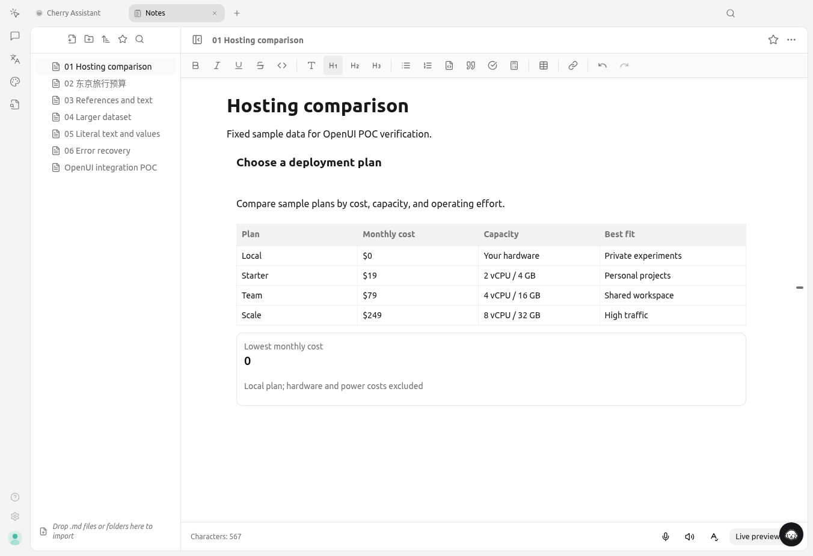
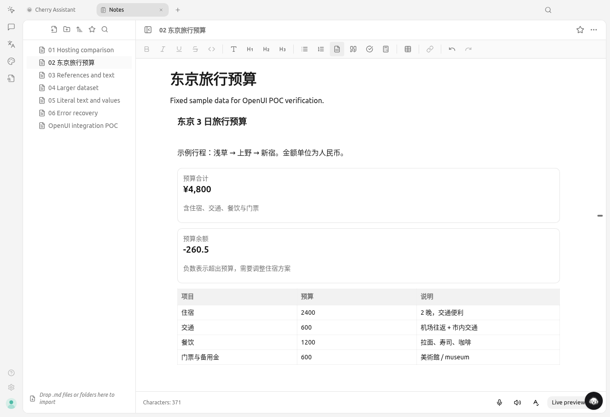
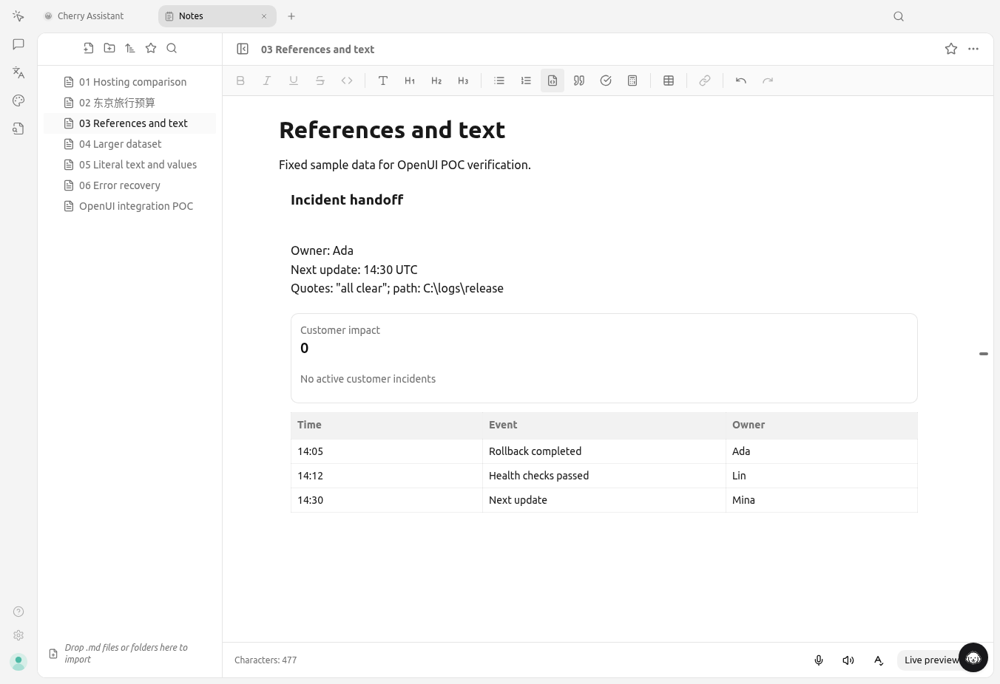
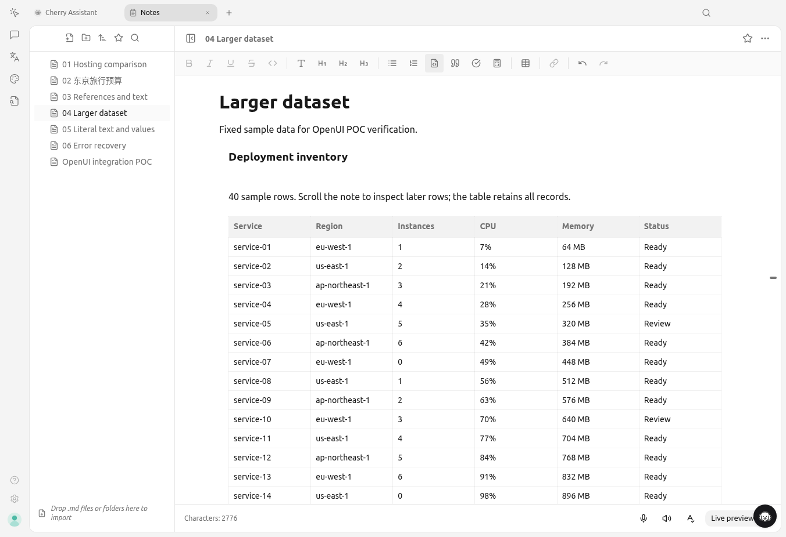
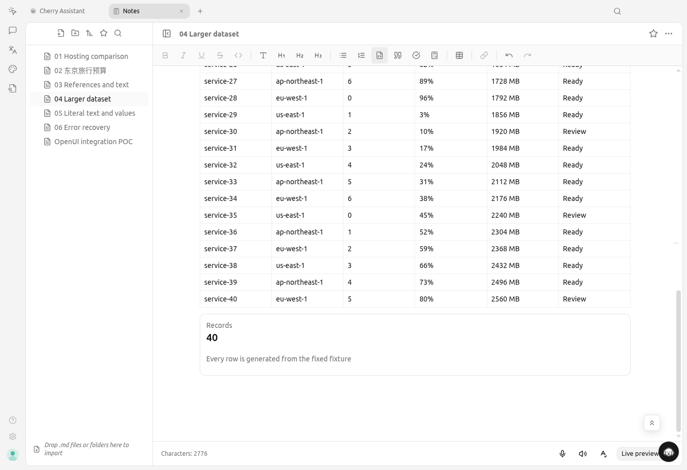
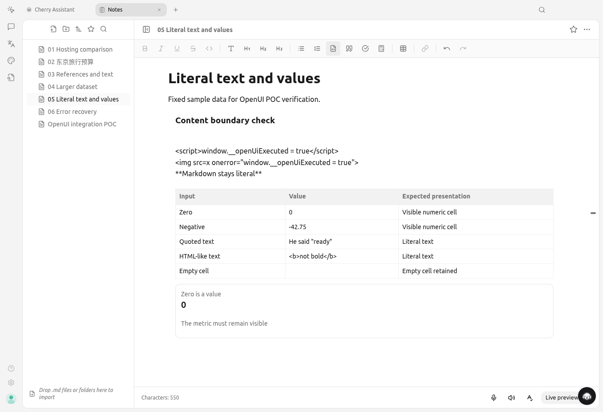
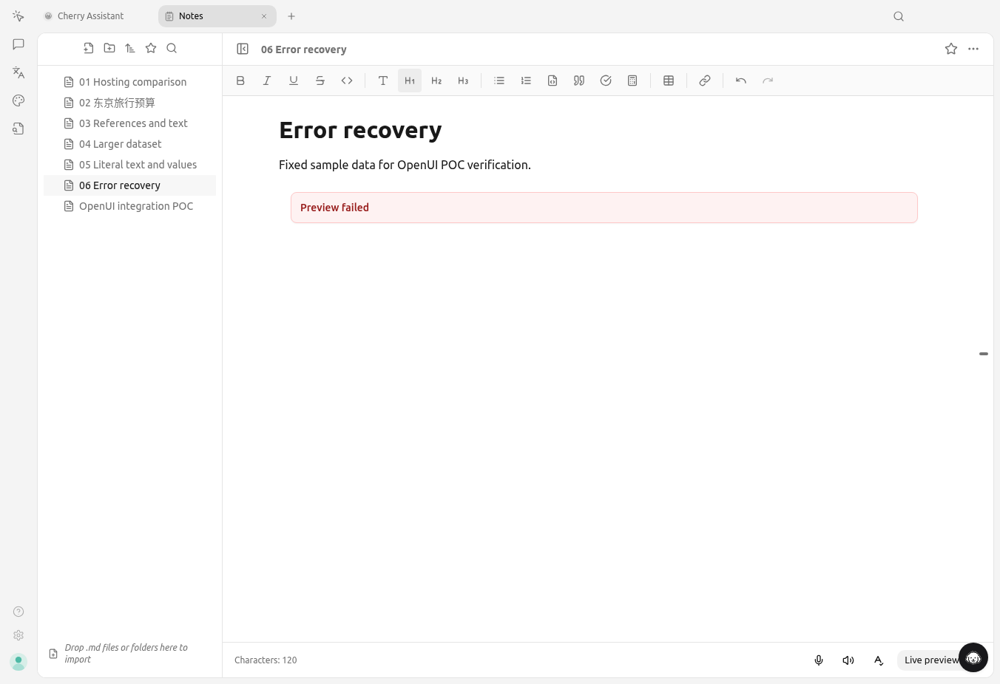
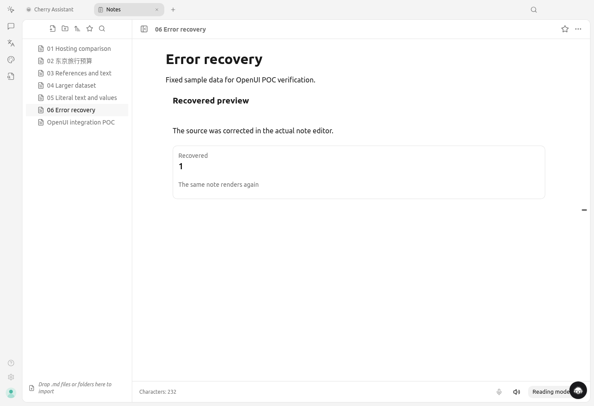

# OpenUI additional runtime examples

These screenshots were captured from the real Cherry Studio Electron window on Linux under Xvfb. The examples use fixed sample data and an isolated development profile. They do not test live model generation.

## Results

All six cases passed in one cold-start run after the Text whitespace fix. See `run.json` for timestamps and the tested renderer source hash. `results.json` records the assertions.

- Hosting comparison: four plans, a zero-value metric, and a comparison table.
- Travel budget: Chinese and Japanese text, the formatted value `¥4,800`, a numeric `-260.5` metric, and numeric table cells.
- Incident handoff: forward references, zero customer impact, line breaks, quotes, and a Windows path. Both text content and visible line breaks were checked.
- Deployment inventory: 40 data rows plus a header. All rows were present, and the last row was scrolled into view.
- Content boundary: zero, negative decimals, an empty cell, and literal HTML-like strings. No script or image elements were created inside the preview, and the test sentinel stayed unset.
- Error correction: an unknown component displayed the preview error. The source was corrected through the real CodeMirror editor and saved to the note file. Switching back to reading mode rendered the correction. This checks recovery after remounting, rather than recovery within one preview instance.

## Finding and fix

The note paragraph styles overrode Text's whitespace utility. Newlines remained in `textContent` but disappeared from the rendered layout. The Text component now uses the repository's `whitespace-pre-wrap!` utility. The runtime check verifies computed `whiteSpace: pre-wrap` and the exact multiline `innerText`.

## Reproduce

Open a fixture Markdown file from this directory in Cherry Studio Notes. The first five fixtures render valid previews. `06-error-recovery.md` intentionally uses an unknown component; replace its source with `06-error-recovery-recovered.md` to check correction.

The local test controller is retained at `.context/cherry-electron-dev/pr-21784/examples/capture-examples.cjs` in the testing checkout. Run it from the repository root against the tracked isolated Electron instance. Its fixture setup script rewrites only the test notes.

## Screenshots

## Limits

These examples exercise Panel, Text, Metric, and DataTable. Charts, forms, actions, live provider responses, mobile layouts, and multiline Metric descriptions were not tested. The SDK's Inspect button is visible because the app ran in development mode.
